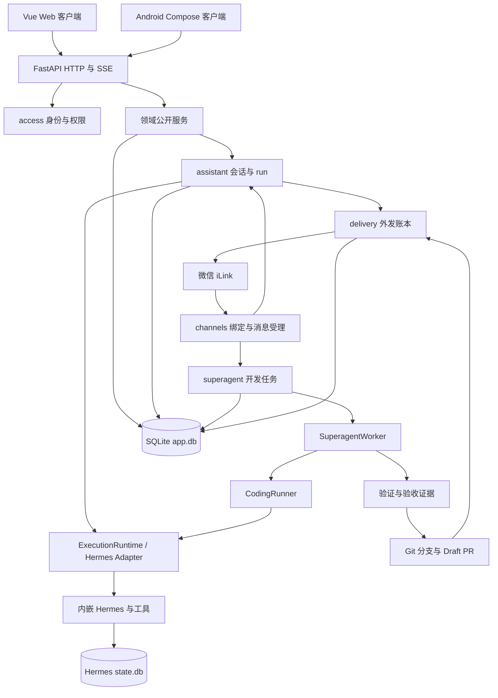

# EasyChat 当前完整架构与源码导览

日期为 2026-11-12。本文以当前磁盘源码、显式装配、路由、配置和调用位置为依据，描述已实现结构。规划文档的功能须另有代码证据才能归入当前链路。（核查方法）

## 1. 阅读范围与逐文件索引

- 项目根目录为 `E:\PythonCode\EasyChat`，本次文件索引覆盖 2,170 个文件、487 个目录，包含当前源码、脚本、配置、文档与资源，以及部分被 Git 忽略但实际存在的项目文件。（本地扫描）
- [逐目录、逐文件 Markdown 索引](./2026-11-12-file-index.md) 列出每个文件的职责、判断依据、文件头与公开符号。目录/文件名推断带明确标记，源码头部摘录保留原文。（索引生成方法）
- [可搜索 HTML 索引](./2026-11-12-file-index.html) 支持搜索路径、职责、类和函数名，可在本地浏览器打开。（交付文件）
- `node_modules`、Gradle/Python 缓存、`data`、`logs`、`out` 等运行或生成目录按用途说明，业务数据与密钥内容省略。产物、缓存和依赖内部文件由相应工具管理。（本次范围选择）
- 本文依据静态源码核查，当前部署版本、在线账号、运行时开关、真实渠道连通及 APK 实机行为需要运行环境证据。（验证范围）

## 2. 整体架构

当前项目为 Python 后端、Vue Web 客户端、Kotlin Android 客户端及微信渠道共同使用的一套业务系统，核心执行适配为 Hermes，业务持久化采用 SQLite。（源码核查，`CLAUDE.md`、`backend/bootstrap.py`、`agent_frontend/package.json`、`android_client/app/build.gradle.kts`）



上图归纳当前源码依赖，实际权限检查在各公开 service 内继续执行。消息、任务、作业和投递分别持有自己的状态及恢复规则。（源码核查，`backend/modules/*/api.py`、`backend/platform/jobs.py`）

## 3. 根目录与目录组织

```text
EasyChat/
├─ main.py                         Python命令行入口
├─ AGENTS.md / CLAUDE.md            仓库约束与当前开发指南
├─ EASYCHAT_HANDOFF.md              能力、实施与交接记录
├─ EASYCHAT_PROGRESS.md             阶段进展记录
├─ README.md                       仓库说明
├─ requirements.txt / pyproject.toml Python依赖及工具配置
├─ backend/                        后端、执行适配及内嵌Hermes
├─ agent_frontend/                 Vue Web客户端
├─ android_client/                 Kotlin Android客户端
├─ docker/                         当前容器部署及历史运维脚本
├─ tests/                          自动化回归与测试支撑
├─ eval/                           上下文和工具相关离线评测
├─ scripts/                        运维、诊断及历史数据实验脚本
├─ sql/                            历史AgentForge SQL和迁移资料
├─ docs/                           设计、执行计划、评审与交付记录
├─ .planning/                      历史阶段计划与研究记录
├─ .github/                        CI工作流
├─ .acceptances/                   本地验收产物目录
├─ data/                           应用库、工件和运行期数据
├─ logs/ / out/                    日志及工具输出
└─ 各类启动/停止bat与检查脚本        本地辅助入口
```

目录树来自磁盘扫描，脚本是否适用于当前服务需结合其内容和调用位置判断。（方法说明）

### 3.1 根目录文件

| 文件 | 当前作用 |
|---|---|
| `main.py` | 创建配置及应用，并由 CLI 启动 Uvicorn 的 `backend.server:app`，代码位置第15、21行 |
| `check_env.py` | 环境与依赖检查辅助入口，具体检查项按文件定义 |
| `AGENTS.md` | 代理执行纪律、保护路径、验证和提交约定 |
| `CLAUDE.md` | 当前入口、模块组织、硬约束和测试命令 |
| `EASYCHAT_HANDOFF.md` | 项目架构与实施交接，部分条目为历史结果 |
| `EASYCHAT_PROGRESS.md` | 阶段完成、问题与验证的历史记录 |
| `pyproject.toml` | Python项目、依赖和 pytest marker 等工具配置，保留 AgentForge 名称 |
| `requirements.txt` | 本地/CI 的较宽依赖清单，生产镜像有单独安装清单 |
| `.gitignore` | Git 忽略规则，磁盘存在文件与Git跟踪清单可能不同 |
| `.dockerignore` | Docker构建上下文过滤 |
| `.coveragerc`、`coverage.xml` | 覆盖率配置与既有覆盖率输出 |
| `restart*.bat`、`start-local.bat` | 本机启动和重启辅助，部分含旧服务控制与本地环境参数 |
| `stop.bat`、`stop-all.bat` | 结束本机进程，历史全停脚本还涉及MySQL |
| `test_pdf_libs.bat` | 本地PDF相关库检查 |
| `test_paper_full.py`、`test_paper_parse.py` | 根目录保留的论文处理试验 |
| `rubric_result.json` | 既有rubric实验结果文件，按名称判断 |
| `=1.2.2` 等文件 | 根目录存在的辅助残留文件，实际生成来源未核实 |

本表综合源码与文件位置核查，实验产物和残留文件的来源属于文件名推断。所有根文件均可在逐文件索引定位。（证据口径）

## 4. 后端启动与装配

### 4.1 入口职责

| 文件 | 职责与证据位置 |
|---|---|
| `backend/server.py` | ASGI模块入口，在第11行调用 `create_app()` |
| `backend/app.py` | 应用工厂、lifespan、错误处理、健康/就绪探针、router和静态资源，第88、145、192行 |
| `backend/bootstrap.py` | 显式依赖装配、启动和逆序关闭，第21、63、425、608行 |
| `backend/bootstrap_tools.py` | 按已装配服务构造提醒、账单、收件箱和编码任务工具，第11行 |
| `backend/registry.py` | 模块服务实例和runtime/worker等运行期引用的容器 |

`main.py` 与 `server.py` 均有模块顶层应用构造，CLI 实际交给 Uvicorn 的是 `backend.server:app`。应用工厂统一，但导入过程可创建不同应用对象。（源码核查，`main.py:15`、`main.py:21`、`backend/server.py:11`）

### 4.2 生命周期

1. 创建 artifacts 目录，读取设置并检查加密密钥，打开 SQLite 应用库并执行迁移。（`backend/bootstrap.py:63`）
2. 构造 access、usage、models、files、profiles、inbox 等基础服务。（`backend/bootstrap.py:87`）
3. 构造 HermesRuntimeAdapter，再接入 assistant、delivery、scheduling、channels 和 superagent。（`backend/bootstrap.py:171`）
4. 按当前模块装配业务工具，安装完成回调、记忆捕获与情绪相关作业，启动后台工作与渠道监听。（`backend/bootstrap.py:425`、`:527`）
5. 启动成功设 ready，关闭时先停渠道和在途运行，再关闭依赖服务与数据库。（`backend/app.py:145`、`backend/bootstrap.py:608`）

### 4.3 HTTP与路由

实际注册包括 access、usage、models、assistant、兼容聊天接口、channels、files、ledger、profiles、inbox、scheduling、delivery/email、memory、skills、superagent/GitHub webhook、evolution。briefing 由其他业务组合调用。（源码核查，`backend/app.py:88`、`backend/bootstrap.py:277`）

路由保留 `/api/profile`、`/api/schedules`、`/api/deliveries` 等产品前缀，assistant还提供 `/chat/stream` 和 `/api/history` 等兼容入口。具体请求字段及前缀以各 `routes.py` 为准。（源码核查，`backend/modules/*/routes.py`、`agent_frontend/src/api/chat.ts`）

## 5. 业务领域模块

`backend/modules/` 当前有16个业务领域。常见 `contracts.py` 定义请求/结果/接口，`api.py` 承担公开业务行为和权限，`repository.py` 管SQL读写，`routes.py` 负责HTTP适配。部分领域通过其他模块组合或采用额外文件拆分。（目录与源码核查）

| 领域 | 职责 | 特别关注的实现 |
|---|---|---|
| `access/` | 登录、用户、角色、权限、Principal和capabilities | `policy.py` 权限集合与能力推导，`repository.py` 用户/角色持久化 |
| `assistant/` | 会话、消息、run提交、取消、流事件与最终投影 | `dispatcher.py` 取run并驱动引擎，HTTP兼容接口沿用Web/Android调用约定 |
| `models/` | 供应商、模型配置、密钥和模型路由 | 模型密钥在受信任路径解密，runtime使用配置选择结果 |
| `usage/` | 调用、Token、成本与用量统计 | 从runtime桥接计量并按用户聚合 |
| `channels/` | 微信账号、扫码、绑定、命令、入站去重和重放 | `wechat/account.py`、`listener.py`、`parser.py`、`media.py`、`urlpolicy.py` |
| `delivery/` | 外发账本、分片、目标验证、重试与uncertain | `worker.py` 投递消费，`wechat.py` 微信，`smtp.py` 邮件，`reports.py` 报告投递 |
| `files/` | 上传、存储、引用、下载、提取和清理 | `local_store.py`、`validation.py`、`lifecycle.py`、`reconcile.py` |
| `ledger/` | 账单导入、候选确认、交易修正、统计与导出 | `parsers/` 确定性格式解析，其余领域文件见索引 |
| `profiles/` | 人格、时区、静默窗口、情绪与关怀偏好 | 偏好影响回答上下文和投递/定时行为 |
| `inbox/` | 稍后读/收藏及后台内容处理 | 与网页提取、简报和微信命令协作 |
| `scheduling/` | 提醒、周期任务、occurrence和调度 | `scheduler.py` 触发到期执行，结果经delivery发送 |
| `briefing/` | 早晚简报/周报生成 | 组合profiles、inbox、news及受控LLM生成，无独立页面router |
| `memory/` | 记忆写入、召回、修订、反馈和遗忘 | 捕获任务和显式管理分别进入公开服务 |
| `skills/` | 技能提案、版本、激活、回滚和runtime快照 | 运行请求携带选定技能版本 |
| `evolution/` | 反馈处理、经验提炼、验证和采纳 | `adoption.py` 与验证/采纳流程 |
| `superagent/` | 开发任务、attempt、输入、报告、Git工作区、验证、发布与验收 | `intake.py`、`runner.py`、`workspaces.py`、`credentials.py`、`verification.py`、`github.py`、`webhooks.py`、`worker.py` |

各行领域职责由公开服务和bootstrap调用核查，文件的完整列表及符号见全量索引。（源码依据）

## 6. 引擎、工具与当前调用链

### 6.1 Runtime与Hermes

- `backend/runtime/contracts.py` 定义 RuntimeRequest、RuntimeEvent 和 `execute/cancel/aclose`，业务依赖该接口。（源码核查）
- `runtime/hermes/adapter.py` 驱动同步Hermes循环，桥接异步事件、缓存、上下文与取消。`paths.py` 设置导入目录和 `HERMES_HOME`，`agent_factory.py` 构造真实 AIAgent 与 SessionDB。（源码核查，`adapter.py:69`、`:126`、`agent_factory.py:14`）
- `tools.py` 注册基础工具与项目业务工具，`usage_bridge.py` 从Agent计数器获取用量差值，`memory_bridge.py` 和 `skills_bridge.py` 连接EasyChat公开能力。（源码核查）
- `sessions.py` 中 SessionMapper 有映射恢复实现，本次全仓搜索只见定义，当前生产实例化调用未确认。（静态搜索范围说明）
- `backend/hermes/` 是内嵌内核，主要 `agent/` 为对话循环、提示词、压缩和工具执行，`tools/` 为内建工具，`providers/` 为模型供应商适配，`hermes_cli/` 为CLI，`gateway/` 为上游渠道能力，`plugins/`、技能目录和其他辅助文件保留上游扩展。（目录与源码核查）

内嵌内核的可选工具和技能需要具体注册与配置才进入某次请求，当前项目显式装配经runtime Adapter完成。（源码核查，`runtime/hermes/tools.py`、`agent_factory.py`）

### 6.2 普通聊天

```text
Web / Android HTTP或SSE请求
    → routes 校验身份与请求
    → AssistantService 创建/恢复session与run
    → RunDispatcher 认领run、构造上下文与ToolContext
    → ExecutionRuntime.execute
    → Hermes模型循环与工具调用
    → runtime事件 → SSE/Web投影
    → 完成事务写结果、memory job及必要delivery
```

来源微信时，前面增加 channels 的绑定、持久入站、命令与媒体处理，最终回答经delivery发送。run的中断与重试有独立状态规则。（源码核查，`assistant/dispatcher.py:83`、`:187`、`:250`、`channels/api.py:413`、`:630`）

### 6.3 微信开发任务

```text
/开发 或 superagent_submit_task / Web受理
    → SuperagentService 写task与来源快照
    → worker从task表认领，创建attempt
    → preparing工作区与base SHA
    → CodingRunner独立Hermes会话
    → 追问进入waiting_input，或进入验证
    → 控制端验证最终代码与发布策略
    → push意图、推送、PR查询复用或创建Draft
    → 终态、报告、回执持久化
```

当前真实编码 worker 一次处理一个任务，runner接口为 `prepare/execute/interrupt`。控制端负责发布和凭据，编码会话收到任务、身份、工作区及工具授权快照。（源码核查，`superagent/worker.py:199`、`runner.py:93`）

GitHub webhook 验签后写入事件和后台job，处理评论、评审、PR和CI状态，满足设置及预算条件时可重新入队修复。验收 rounds/checks 已有迁移、repository和API，属于当前源码能力。（源码核查，`superagent/webhooks.py:102`、`:236`、`superagent/api.py:516`、`0025_superagent_acceptance.sql`）

### 6.4 其他后端目录

| 目录 | 当前作用与接入证据 |
|---|---|
| `shared/` | `context.py` 可信身份与运行上下文，`tool_context.py` 工具来源与身份，`crypto.py` 加密，`errors.py` 错误，`identifiers.py` 标识，`text.py/wechat_text.py` 文本处理 |
| `integrations/` | `llm.py` OpenAI兼容生成，`speech.py` STT，`news.py` Feed，`pdf.py` 报告渲染，`search.py` 搜索；MCP与script runner的当前主装配需单独核实 |
| `tools/business/` | 提醒、账本、收藏和superagent模型工具，由 `bootstrap_tools.py` 接入 |
| `tools/tools_decorator.py` | 当前基础时间/todo/解析工具入口，仍由Hermes适配层调用 |
| `tools/paper_reproduction/` | 保留论文解析、rubric、仓库发现、sandbox与证据等历史能力，默认项目工具列表已移除其注册 |
| `tools/text_to_sql.py`、`kg_tools.py` 等 | 保留的旧领域工具，默认注册范围以 `get_project_tools()` 为准 |
| `context/` | 上下文策略工厂、任务状态和证据；`tool_results/` 为原始结果存储、压缩、选择和受限视图，完整启用装配需核实 |
| `utils/` | 日志、用量、Token、限流等辅助及历史数据库/模型工具；如 `rate_limit.py` 仍由当前app引用 |
| `config/` | 路径配置、模型元数据和结构参考 |
| `templates/` | PDF等输出模板 |

本表按显式引用和静态搜索区分文件职责，旧工具的存在与当前默认注册分别判断。（源码核查，`bootstrap.py`、`bootstrap_tools.py`、`tools_decorator.py:897`、`context/tool_results/runtime.py:29`）

## 7. 存储、队列与恢复

### 7.1 存储

- `app.db` 保存用户、权限、模型、会话、run、消息、jobs、渠道、delivery、记忆、技能、账单、偏好、提醒、superagent任务与验收等业务状态，当前有 `0001` 到 `0025` 的追加迁移。（迁移源码核查）
- Hermes 使用自己的 `state.db`。默认 bootstrap 把 home 设为 `artifacts/hermes`，结合默认数据目录推断实际路径为 `data/artifacts/hermes/state.db`，部署配置可改变根目录。（源码与默认值推断，`bootstrap.py:173`、`platform/settings.py`、`hermes/hermes_state.py:260`）
- `AppSettings.state_db_path` 另定义 `data/state.db`，本次搜索未发现当前生产消费。文档应按实际构造路径理解两者。（静态搜索）
- 文件与验证工件在 artifacts 管理，包括编码工作区和 `superagent_verify` 日志。运行数据不纳入逐文件内容扫描。（源码与扫描范围）

### 7.2 四类持久执行状态

| 状态载体 | 用途 |
|---|---|
| assistant runs | 普通聊天执行、流事件、取消与中断 |
| superagent tasks/attempts | 编码任务生命周期、工作区与发布检查点 |
| platform jobs | 记忆捕获、webhook及其他后台工作的租约和重试 |
| delivery/parts | 外发、分片、已发送记录、重试及结果未知 |

这些载体分别由对应服务认领和恢复，superagent编码任务直接从任务表认领，webhook处理使用jobs。（源码核查，`platform/jobs.py:47`、`superagent/worker.py:199`、`:211`、`delivery/api.py:191`）

### 7.3 数据一致性与权限

数据库连接设置外键和busy timeout，写事务默认 `BEGIN IMMEDIATE`，异常回滚，迁移逐条执行并检查checksum。WAL实现对已经处于WAL的库保留其模式，其他库的新启用路径检查版本后决定WAL或DELETE。（源码核查，`platform/sqlite.py:37`、`:79`、`:187`）

AGENTS/CLAUDE 对版本守卫有简述，上述是当前源码的精确分支行为。（说明依据）

身份经access和Principal建立，模型工具使用ToolContext，service继续检查能力及owner。密钥由 `EASYCHAT_ENCRYPTION_SECRET` 支持的加密路径管理，渠道与无人值守能力有显式开关。（源码核查，`shared/tool_context.py`、`shared/crypto.py`、`platform/settings.py`）

重启后的在途run/task可能转为interrupted并要求后续显式处理，发布重试先对账远端分支和PR，投递对已sent分片跳过并保留uncertain语义。（源码核查，`assistant/dispatcher.py:83`、`superagent/worker.py:157`、`delivery/api.py:245`）

## 8. Web客户端

### 8.1 目录和核心文件

| 路径 | 作用 |
|---|---|
| `index.html` | 提供 `#app`，加载 `src/main.ts` |
| `src/main.ts` | 创建Vue，安装Pinia、持久化、Router、Element Plus、权限指令与样式 |
| `src/App.vue` | 侧栏和router-view壳层、登录态检查 |
| `src/router/index.ts` | Hash路由、懒加载与鉴权/capability守卫 |
| `src/views/` | 页面容器和业务交互 |
| `src/views/admin/` | 管理布局、用户列表、角色列表、编辑弹窗及权限升级预览 |
| `src/components/` | 侧栏、消息气泡、聊天历史等可复用组件 |
| `src/api/request.ts` | Axios JSON客户端，Bearer、超时、刷新和错误归一化 |
| `src/api/chat.ts` | SSE ticket/EventSource和POST fetch流、事件分派与取消 |
| `src/api/*.ts` | auth、session、admin、permissions、config、platform、wechat、ledger、superagent领域客户端 |
| `src/stores/auth.ts` | token、账号、权限、capabilities和登录生命周期 |
| `src/stores/chat.ts` | 按会话保存消息、流和恢复信息 |
| `src/stores/sidebar.ts` | 历史会话、筛选、分页和修改 |
| `src/composables/useChat.ts` | 上传、发送、停止、历史、审批和重连 |
| `src/utils/` | 权限分组、Markdown、错误、UUID、下载、面板宽度等纯逻辑 |
| `src/types/` | auth/chat的TypeScript结构 |
| `src/styles/design-system.css` | 设计变量、视觉与基础布局 |
| `vite.config.js` | 端口3000、别名、构建及到8001的代理 |
| `tests/` | Node test runner的API、角色模式和UI工具逻辑回归 |

上表以imports、路由及客户端调用核查，逐文件列表在索引。（源码依据）

### 8.2 全部页面

| 路由 | 页面文件 | 用途 |
|---|---|---|
| `/login` | `LoginView.vue` | 登录 |
| `/chat` | `ChatView.vue` | 会话、附件、流响应、工具状态及执行审批 |
| `/skills` | `SkillsView.vue` | 技能与版本管理 |
| `/wechat` | `WeChatSettingsView.vue` | 微信偏好、情绪记录、稍后读 |
| `/schedules` | `SchedulesView.vue` | 提醒创建、启停、删除与执行记录 |
| `/ledger` | `LedgerView.vue` | 账单导入、统计、修正和导出 |
| `/superagent` | `SuperagentView.vue` | 开发任务、仓库设置、执行与验收相关面板 |
| `/memory` | `MemoryView.vue` | 记忆读取、召回、修订与遗忘 |
| `/trace` | `UsageView.vue` | 用量、Token与排行 |
| `/admin` | `AdminView.vue` | 用户与角色管理 |
| `/config` | `ConfigView.vue` | 模型、渠道、邮件、绑定及模型路由配置 |

根 `/` 重定向聊天，页面名称与路径存在历史命名。实际注册见 `agent_frontend/src/router/index.ts:5` 至第76行。（源码核查）

## 9. Android客户端

### 9.1 工程与装配

项目为 Kotlin/Compose 单app工程，名为XiaoNuan，applicationId为 `com.easychat.family`，当前声明版本0.1.0，minSdk29、target/compileSdk36、JVM17。（源码核查，`android_client/app/build.gradle.kts:10`）

| 路径（android_client 下） | 作用 |
|---|---|
| `settings.gradle.kts` | 工程、仓库和app模块声明 |
| `build.gradle.kts` | Android/Kotlin/Compose插件版本 |
| `gradle/libs.versions.toml` | Compose、Lifecycle、OkHttp、Serialization和DataStore等版本 |
| `gradlew`、`gradlew.bat`、`gradle/wrapper/` | Gradle Wrapper入口与版本 |
| `app/src/main/AndroidManifest.xml` | Application、Activity、权限和分享Intent声明 |
| `app/.../app/MainActivity.kt` | Activity进入Compose主题和根页面 |
| `app/.../app/XiaoNuanApp.kt` | 欢迎、连接、登录、四Tab和会话详情导航 |
| `app/.../app/AppContainer.kt` | 手工装配存储、API、SSE与各仓储 |
| `app/.../core/network/` | HTTP、SSE、认证、聊天、生活和日程仓储 |
| `app/.../core/storage/` | DataStore连接与账号信息、Keystore token加密 |
| `app/.../core/model/Dto.kt` | 服务端响应DTO |
| `app/.../core/designsystem/` | 主题、调色板、字体、间距与组件 |
| `app/.../core/util/XnTime.kt` | 时间展示与转换 |
| `app/.../feature/` | onboarding、today、chat、life、profile功能页面与状态 |
| `app/src/main/res/` | 字符串、主题、颜色与图标等平台资源 |
| `app/src/test/` | 对比度、字号与时间逻辑测试 |

表中的 `app/.../` 完整前缀为 `app/src/main/java/com/easychat/family/`，全路径见文件索引。（路径说明）

### 9.2 实际业务能力与边界

Android已调用healthz/readyz、登录/me、history、chat流和取消、schedules、memory、inbox等HTTP入口，聊天状态含提交、流式、恢复、取消与失败。生活页有日程创建/启停/删除、记忆与收藏读取。（源码核查，`core/network/*Repository.kt`、`feature/chat/ChatViewModel.kt:34`、`feature/life/LifeScreen.kt:50`）

“我的”中部分偏好仍为硬编码或空回调，厨房为规划卡片，系统分享发现Manifest声明但完整Intent处理未确认。语音、朗读、真实家人设备与部分恢复验收仍属于交付文档待办。（源码核查及搜索范围，`ProfileScreen.kt:32`、`MainActivity.kt:9`、`docs/superpowers/specs/2026-11-12-android-family-wp5-delivery.md:50`）

后端契约草稿单独标明待人工决策，字段完成状态须回到实际router/service核实。磁盘存在debug APK，此次只确认产物存在，运行行为未复验。（源码与文件核查）

## 10. 部署、测试、评测与运维目录

### 10.1 当前容器部署

`docker/Dockerfile` 使用Node22构建Web、Python3.12运行后端，将dist复制为static，安装 `docker/requirements-core.txt` 与 `requirements-hermes.txt`，启动单worker的 `backend.server:app`。compose当前定义一个easychat服务、数据卷、健康检查、日志与默认关闭的能力开关。（源码核查，`Dockerfile:5`、`:23`、`:39`、`docker-compose.yml:5`）

部分 `docker/health_check.sh`、`fix_neo4j_port.ps1` 和根重启脚本仍引用旧MySQL/Neo4j/Milvus/Redis部署，属于需按具体脚本判读的历史辅助内容。（源码核查，`docker/health_check.sh:44`）

### 10.2 测试

当前测试分类包括access、architecture、assistant、briefing、channels、context_results、contracts、delivery、evolution、files、inbox、integration、ledger、memory、models、profiles、resources、scheduling、security、services、skills、storage、superagent、tools、usage。（目录扫描）

`tests/support/rig.py` 使用真实临时SQLite和FakeRuntime组合服务；contracts覆盖HTTP/SSE/runtime和客户端契约，storage覆盖迁移与备份，architecture检查导入与退役依赖。integration/resources依赖真实系统或资源环境。（源码核查，`tests/conftest.py`、`pyproject.toml`）

`tests/conftest.py:25` 默认忽略 `tests/` 根层旧 `test_*.py`，测试目录中的文件总数不等于维护套件的用例数。前端Node逻辑测试与真实浏览器交互分别提供不同证据。（源码核查）

`.github/workflows/ci.yml` 配置后端pytest、重点路径严格ruff及全仓提示检查、前端npm test/type-check/build。Android自身有Gradle测试入口，当前CI覆盖范围按实际workflow确认。（源码核查）

### 10.3 脚本和资料

- `scripts/files_ledger_backup.py` 调用当前platform备份机制，支持备份、校验与恢复模式。（源码核查）
- `scripts/kb/` 及大量图、向量、红楼梦/三国相关脚本为历史知识库实验与迁移，部分导入旧backend.db，运行前需核对依赖与对象。（源码核查）
- `sql/agentforge_schema.sql` 和 `migrate_memory_mem_key.py` 为旧MySQL/Neo4j体系资料，当前应用迁移位于platform/migrations。（源码核查）
- `eval/context_budget/` 包含上下文策略对照、消融、worker、数据集与指标，README区分已准备与实际运行结果。（源码核查）
- `docs/superpowers/specs/` 保存架构与产品设计，`plans/` 保存实施方案，`docs/reviews/` 保存核查和交付证据，`.planning/` 保存历史分阶段记录。（目录与文件头核查）
- `.acceptances/`、`.playwright-mcp/`、`.pytest_cache/`、`.ruff_cache/`、`__pycache__/`、`node_modules/`、`.gradle/`、`app/build/`、`dist/` 等按验收工具、构建或缓存用途理解，其出现与对应产品能力启用分别核实。（目录约定与存在性核查）

## 11. 如何按功能定位文件

| 想理解的行为 | 建议阅读顺序 |
|---|---|
| 系统启动 | main → server → app → bootstrap → registry/settings |
| 登录与权限 | access/routes → api → policy → repository → shared/context |
| 聊天与流 | Web useChat/api/chat 或 Android ChatRepository → assistant routes/api → dispatcher → runtime adapter |
| 微信 | channels routes/api → commands → wechat listener/account/parser/media → assistant或superagent |
| 自动编码PR | superagent intake/tools → api/repository → worker → runner → verification → github → delivery |
| 验收反馈 | superagent routes/api/repository → 0025迁移 → SuperagentView |
| 提醒与简报 | scheduling api/scheduler → briefing/profiles/inbox → delivery |
| 账单与文件 | files上传/引用 → ledger parser/api/repository → 报告与delivery |
| 上游内核适配 | runtime/contracts → hermes/adapter/agent_factory/tools → backend/hermes |
| 历史功能 | tools默认注册列表、bootstrap和app显式注册，再对照旧脚本与资料 |

阅读顺序是基于调用位置的导览建议，逐文件索引可以继续追踪符号。（方法说明）

## 12. 说明与尚需运行验证的事项

本文与索引是当前源码快照。文件职责中大量上游/历史/实验文件依据目录、名称和原始文件头归纳，索引逐项标注依据，运行可达性以本文列出的明确调用位置为准。（方法局限）

当前已有验收数据结构与API，完整Acceptance工具自动生成、本地HTML反馈和其他规划功能的端到端打通仍需独立运行证据。Android的部分页面占位、语音/分享与发布验收也应依据当前交付待办理解。（源码核查及未验证范围）

此次只执行结构扫描、源码解析与文档索引校验，历史测试和APK产物按历史/存在性证据引用。（本轮操作范围）
