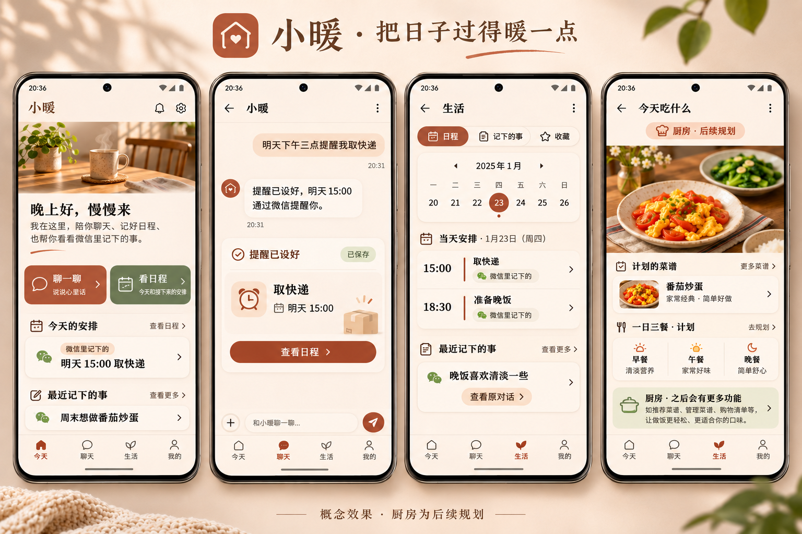

# EasyChat 家庭 Android 客户端完整设计方案

日期为 2026-11-11，工作目录为 `E:\PythonCode\EasyChat`，源码基线为 `2d4311e`。（源码核对）

本文供产品设计与实施模型交接，包含产品范围、视觉规范、页面交互、接口对接、扩展设计、实施顺序与验收条件。（设计提案）

## 1. 已确认需求与默认决策

- 首版围绕聊天陪伴、日程提醒，以及在 App 查看微信沟通后记录的事情展开。（用户已确认）
- 为家人使用，界面要求精致、温馨，厨房菜品能力预留到后续阶段。（用户已确认）
- 产品展示名暂定「小暖」，项目与技术名称沿用 EasyChat，命名可在实施前整体替换。（设计默认，待用户审阅）
- 技术路线建议采用 Kotlin + Jetpack Compose 的原生 Android 客户端，复用现有 Python 服务端。（设计建议）
- 首版按每位家人拥有自己的 EasyChat 账号设计，共享厨房另设后续阶段。（设计默认，依据现有 owner 数据归属）
- 最低系统暂定 Android 10 / API 29，实施前根据家人真实机型确认，targetSdk 与依赖版本在实施时按官方稳定版本和兼容矩阵锁定。（设计默认）
- 默认时区为 Asia/Shanghai，时间以服务端记录为准，界面展示用户时区。（设计默认）

### 1.1 首版能力范围

| 优先级 | 能力 | 交付边界 |
| --- | --- | --- |
| P0 | 登录与服务器连接 | 家人首次配置、登录、权限同步、会话保持、退出清理 |
| P0 | 聊天陪伴 | 文字、图片、流式回答、历史、取消、断线恢复 |
| P0 | 微信内容查看 | 当前账号绑定渠道中已进入 EasyChat 的会话、提醒、记忆、收藏 |
| P0 | 日程提醒 | 列表、按日查看、新建、暂停、恢复、删除、查看触发记录 |
| P0 | 记下的事 | 读取个人记忆，区分偏好、事件与事实，展示保存状态 |
| P0 | 温馨视觉与无障碍 | 暖色主题、深色主题、大字、TalkBack、清楚的状态反馈 |
| P1 | 收藏与分享接入 | 查看收藏，系统分享文字/链接到小暖，确认后保存 |
| P1 | 微信来源精确回看 | 源消息定位、记录关联、来源标签、可靠的增量刷新 |
| P1 | 语音便利功能 | 按设备能力启用语音转文字、手动朗读回复 |
| P2 | 厨房 | 私人菜谱、今日菜单、做菜步骤、购物清单 |
| P3 | 共享家庭厨房 | 家庭成员、分享授权、共享菜单、多人编辑 |

以上为分期建议，P0 包含微信历史和已落库记录的基本查看，P1 完善精确溯源。（设计提案）

### 1.2 技术路线取舍

| 路线 | 收益 | 成本 | 适用判断 |
| --- | --- | --- | --- |
| Kotlin + Compose | 原生输入、无障碍、生命周期、系统分享与通知集成集中 | 新增 Android 工程与客户端接口层 | 推荐，当前用户明确需要 Android |
| Flutter | 后续多平台复用界面 | 新增 Dart 技术栈与平台插件适配 | 已明确 iOS 计划时再评估 |
| Vue 移动布局 + Android 容器 | 可利用现有 Vue 经验和接口逻辑 | 现有桌面页面需重新布局，系统能力与流式生命周期仍需适配 | 快速验证阶段可选 |

Compose 与 ViewModel、单向数据流符合 Android 官方建议，本文路线选择是面向本项目的推断。（官方文档与设计推断）[Android 架构建议](https://developer.android.com/topic/architecture/recommendations)

## 2. 当前代码能力与证据

下表为源码核对结果，接口存在性与行为以表内文件为证据，线上部署可用性需要实施时实测。（源码核对）

| 领域 | 已有实现 | 对客户端的意义 | 代码证据 |
| --- | --- | --- | --- |
| 服务装配 | FastAPI 显式注册模块路由 | Android 直连现有 HTTP 服务 | `backend/app.py::_register_explicit_routers` |
| 身份 | 登录、me、refresh、权限与 capabilities | 登录后用 me 建立真实身份与入口权限 | `backend/modules/access/routes.py` |
| 对话 | POST SSE、历史、取消、事件序号恢复 | 移动聊天主链可复用 | `backend/modules/assistant/routes.py` |
| 微信 | binding 决定用户，source=wechat 进入统一 Assistant | 同账号可查看微信会话投影 | `backend/modules/channels/api.py` |
| 跨渠道会话 | list_sessions 按 owner 查询，返回 source | 会话列表可包含 Web 与微信来源 | `backend/modules/assistant/repository.py::list_sessions` |
| 提醒 | 一次、间隔、每日、每周，暂停与触发实例 | 支持日程列表与明确频率的新建表单 | `backend/modules/scheduling/routes.py`、`contracts.py` |
| 记忆 | fact/preference/event/experience 与来源引用 | 支持「记下的事」 | `backend/modules/memory/routes.py`、`contracts.py` |
| 收藏 | 列表、搜索、保存、归档、删除 | 支持文章、链接、文件与笔记收藏 | `backend/modules/inbox/routes.py` |
| 个人偏好 | 称呼、人设、安静时段、时区、情绪开关 | 支持「我的」中的陪伴设置 | `backend/modules/profiles/routes.py` |
| 文件 | 上传与 owner 授权下载 | 图片与文件统一存储 | `backend/modules/files/routes.py` |
| Web 参考 | Vue 3、Pinia、桌面路由与蓝色设计系统 | 可参考操作流程与 DTO 适配 | `agent_frontend/package.json`、`src/router/index.ts`、`src/styles/design-system.css` |

已实测 `python -m pytest tests/assistant/test_channel_identity.py -q -k cross_channel_shares_owner_but_sessions_are_independent`，结果为 `1 passed, 7 deselected in 4.76s`，覆盖同一用户的 Web 与微信独立会话和渠道身份。（实测，2026-11-11）

### 2.1 对设计有影响的现有边界

- 微信可见内容来源于已绑定账号进入 EasyChat 的记录，数据源包括会话投影、schedule、memory、inbox。（源码证据 `channels/api.py`、各模块路由）
- 历史消息 HTTP 响应只返回 role、content、created_at，精确定位所需的 message_id、run_id、附件与单条消息来源尚需扩充公开读取响应。（源码证据 `assistant/routes.py::history_messages`）
- 微信斜杠命令可直接在渠道模块执行，需单独核对其会话投影完整性，尤其是 `/存` 等命令的原始请求与回复。（源码证据 `channels/api.py::_handle_command` 调用分支、`channels/commands.py`）
- 提醒计划当前具备 enabled 和触发实例，通用待办的「已完成」与「任意修改计划」需要后续契约，工具层已具备 reminder_snooze，手机客户端的稍后提醒还需要对应 HTTP 入口设计。（源码证据 `scheduling/routes.py`、`contracts.py`、`backend/tools/business/reminder_tools.py`）
- 提醒创建默认从有效微信绑定解析目标，也可提供邮箱目标，App 专用推送目标需另行建设。（源码证据 `scheduling/routes.py::_target`）
- 当前提醒对象缺少 origin_session_id / origin_message_id 等来源字段，只有明确证据的记录才能显示「微信里记下的」。（源码证据 `scheduling/routes.py::_schedule_dict`）
- 当前历史按 sessions.updated_at 排序，需核验各写入链路是否持续更新时间，以及活跃过滤后的分页行为。（源码证据 `assistant/repository.py::list_sessions`、`assistant/routes.py::history_list`）
- Web 层仍保留已经停用的反馈和审批调用入口，手机客户端接入范围按服务端当前路由行为确定。（源码证据 `assistant/compat.py`、`agent_frontend/src/api/chat.ts`）

## 3. 产品气质与视觉方向

整体定位为「安静地陪家人聊天，把说过的事放在容易找到的地方」，温馨感通过自然材质、舒服的间距、简短体贴的文案与可靠的反馈形成。（设计提案）

### 3.1 视觉效果图



效果图使用内置 imagegen 生成，呈现首页、聊天、生活、后续厨房四个场景，所有记录与日期均为示例。（设计素材说明）

生成图中的中文、月份、导航选中态与提醒确认文案需要按本文规范重新实现和校验，日期示例统一替换为测试场景日期。（人工目检）

聊天中的结构化提醒卡片属于 P1 增强，需要真实业务回执或关联记录支持，P0 以对话文本和独立日程列表呈现。（设计提案）

### 3.2 色彩与材质

| Token | 浅色值 | 使用位置 |
| --- | --- | --- |
| background | `#FFF8F0` | 整体奶油底色 |
| surface | `#FFFCF8` | 卡片、底部导航与弹层 |
| primary | `#A94E34` | 主要操作、选中态、发送按钮 |
| primaryContainer | `#F7DDCB` | 用户气泡、选中胶囊 |
| sageContainer | `#E8EDDF` | 提醒与保存状态辅助底色 |
| sageText | `#46583B` | 辅助状态文字 |
| textPrimary | `#3F3029` | 标题与正文 |
| textSecondary | `#6D5D52` | 时间、说明与来源 |
| outline | `#E7D9CD` | 分隔线与输入边界 |
| error | `#A43B32` | 错误与危险操作 |

以上为待实施验证的设计色值，文字组合需通过对比度检测，正文目标至少 4.5∶1，大字与交互图形目标至少 3∶1。（设计验收目标）

深色主题建议使用 `#211D19` 背景、`#2D2722` 表面、`#F4E9DD` 正文、`#F0AF91` 主色，保留暖色气质。（设计提案）

- 家居主图使用自然光下的木桌、陶杯、亚麻、绿植，图片比例约为首页首屏的 20%～25%。（设计提案）
- 菜品图片以真实家常菜与自然光拍摄为方向，后续上传的家庭实拍可用作私人菜谱封面。（设计提案）
- 卡片使用轻微暖灰阴影与 1dp 暖色边线，正文区域使用纯色底。（设计提案）
- 图标采用统一圆角线性风格，导航文字常驻，状态同时使用图标与文字。（设计提案）

### 3.3 排版、尺寸与动效

| 项目 | 规范 |
| --- | --- |
| 中文字体 | 系统中文字体优先，离线可用，避免首屏字体下载依赖 |
| 拉丁与数字 | 可使用已授权且随包分发的 Nunito，数字保持清晰与对齐 |
| 页面标题 | 26sp，medium，行高 34sp |
| 卡片标题 | 20sp，medium，行高 28sp |
| 正文 | 17sp，regular，行高 27sp |
| 辅助文字 | 14sp，行高 20sp，关键信息随系统字号放大 |
| 页面边距 | 20dp，组件间距使用 4/8/12/16/24/32dp |
| 卡片圆角 | 20dp，弹层 28dp，输入区 24dp |
| 点击区域 | 至少 48dp，主要按钮高度 52～56dp |
| 大字适配 | 验证 1.0×、1.3×、1.5×、2.0×系统字体，操作可换行 |
| 动效 | 点击 120ms，状态切换 180ms，页面过渡 240ms |
| 流式刷新 | 约 30～50ms 合并文本更新，保持滚动稳定 |

以上数值均为实现目标，系统减少动画设置开启时使用淡入或直接切换。（设计提案）

### 3.4 文案与陪伴方式

| 场景 | 文案示例 |
| --- | --- |
| 首次打开 | 「你好，我是小暖。想聊的时候，来这里坐坐。」 |
| 首页晚间 | 「晚上好，今天过得怎么样？」 |
| 今日无安排 | 「今天还没有安排。想记点什么，随时告诉我。」 |
| 提醒保存成功 | 「记好了，明天 15:00 通过微信提醒你。」 |
| 提醒结果待确认 | 「正在确认是否记好，请稍等一下。」 |
| 网络中断 | 「连接暂时断开了，你写的内容还在。」 |
| 微信来源 | 「微信里的对话」「微信里记下的」 |
| 收藏成功 | 「收好了，下次可以在收藏里找到。」 |
| 保存失败 | 「这次还没保存成功，点这里再试一次。」 |

成功文案必须由对应保存回执触发，称呼默认取 profile.address_form，情绪记录按用户 opt-in 设置启用。（设计提案，依据 `profiles/routes.py`）

## 4. 信息架构与导航

底部固定四个入口，页面内按用户任务组织内容。（设计提案）

```text
今天
  问候与开始聊天
  今天 / 接下来的安排
  最近记下的事
  最近微信对话
聊天
  会话列表，支持全部 / 微信 / App 筛选
  App 新对话
  对话详情
  微信对话查看与带背景新聊
生活
  日程
  记下的事
  收藏
  厨房入口，功能上线后显示
我的
  账号与微信绑定状态
  称呼与陪伴偏好
  字号、主题、朗读
  时区与安静时段
  连接设置、缓存管理、版本、退出
```

首版「生活」可把收藏作为二级入口，厨房的导航位置与组件样式在设计中预留，正式入口随实际能力发布。（设计提案）

应用首次进入「今天」，点击「聊一聊」一步进入输入区，输入草稿按账号与会话分别保存。（设计提案）

## 5. 核心页面规格

### 5.1 首次连接与登录

- 欢迎页仅保留品牌、简短说明、「开始使用」与服务器配置入口。（设计提案）
- 家人可输入服务地址或扫描配置二维码，二维码只含服务地址和显示名，登录仍走现有 username/password。（设计提案）
- 连接检查依次验证 `/healthz` 与 `/readyz`，展示「连接成功」「正在启动」「地址暂时连不上」。（设计提案，依据 `backend/app.py`）
- 登录后读取 `/api/auth/me`，加载真实用户、permissions、capabilities 与个人偏好。（设计提案）
- 设置页展示微信绑定状态与相关说明，微信账号的绑定与变更沿用现有授权流程。（设计提案）
- 默认启用 HTTPS 服务地址，家庭内网联调如需 HTTP，使用明确的开发构建配置并在连接页标明连接类型。（设计提案）

### 5.2 今天

从上到下依次为顶部头像与称呼、自然光主图、问候语、两个大按钮、今日安排、最近记下的事和微信对话入口。（设计提案）

- 两个大按钮为「聊一聊」「看日程」，首屏至少露出一条真实安排。（设计提案）
- 安排卡片包含时间、标题、目标渠道、启用状态，来源字段齐备时增加来源标签。（设计提案）
- 最近记下的事最多展示三条，显示内容摘要与记录时间，点击到记录详情。（设计提案）
- 最近微信对话显示「微信」来源、标题和更新时间，点击打开只读历史。（设计提案）
- 页面显示「更新于 HH:mm」，网络恢复、回到前台、手动下拉与业务保存成功时触发刷新。（设计提案）
- 提醒、记录、对话分别加载，单个接口失败保留其他区块并在该区块提供重试。（设计提案）

### 5.3 聊天列表与对话

- 列表项显示标题、来源、时间，首版搜索可明确限定为已加载会话标题，全文搜索随后端能力单独上线。（设计提案）
- 对话采用暖杏用户气泡、奶白助手气泡，助手头像固定小尺寸，长文本左对齐。（设计提案）
- 输入区具备文字输入、图片选择、发送与生成中停止按钮，附件上传有明确进度和失败状态。（设计提案）
- 接收到正文前显示「正在想一想」，正文生成后显示流式内容，用户上滑阅读时保留当前位置，并显示回到底部按钮。（设计提案）
- Markdown 支持段落、列表、链接、引用和代码块，外链通过系统浏览器打开，远端 HTML 以安全文本或受控渲染呈现。（设计提案）
- 生成中的回复可继续阅读，界面离开与网络流断开分别处理，用户明确点击停止时请求服务端取消。（设计提案）
- 长按支持复制，手动朗读在设备支持时显示，语音识别先生成可编辑文字草稿再由用户发送。（设计提案）

微信历史页优先提供查看，底部按钮为「带着这段聊一聊」，点击后在新建 App 会话中生成可编辑的背景引用草稿，用户发送后才提交。（设计提案）

微信与 App 会话的来源及发送路径需要在服务端明确，采用独立 App 会话可以保持与现有渠道路由语义一致。（设计推断，依据 `RunCommand.source` 与 `channels/api.py::source_route_for_session`）

### 5.4 日程

- 顶部为月份切换与周日历，下面按「当天」「接下来」展示计划，月视图可以切换。（设计提案）
- 计划卡显示具体时间、重复规则、内容与投递渠道，点击进入详情查看触发实例。（设计提案）
- 创建页使用标题、内容、日期时间、重复规则、时区、提醒渠道，确认区域用自然语言复述下一次提醒时间。（设计提案）
- 首版重复规则开放一次、每日、每周，间隔规则可放入高级设置，并按服务端实际约束验证。（设计提案）
- 暂停与恢复使用 enabled，删除需确认，表单草稿在失败后保留。（设计提案）
- 首版修改时间可提示用户创建新计划并明确处理旧计划，正式编辑能力在服务端具备原子更新契约后开放。（设计提案）
- 计划详情呈现「下次提醒」「最近触发」「投递渠道」，触发与投递成功分别按各自回执展示。（设计提案）

循环计划的某天展示需要由时区、重复规则与当前启用状态计算，并与 occurrence 记录区分，未来计划显示「预计提醒」，真实实例显示实际状态。（设计提案）

### 5.5 记下的事

- 列表以「偏好」「重要的事」「生活信息」呈现 preference、event、fact，experience 可在详情或更多分类中展示。（设计提案）
- 详情显示完整内容、来源类型、记录时间、事件时间、source_refs，以及「改一下」「忘掉这条」操作。（设计提案）
- model_inferred 对应「小暖整理的，点此确认或修改」，user_confirmed 对应「你确认过的记录」。（设计提案）
- 「忘掉」操作通过 memory 的公开删除或 forget 接口执行，成功后同步清理客户端对应投影。（设计提案）
- 通用事件记忆显示事实内容与事件日期，只有真实 schedule_id 对应的记录展示提醒状态。（设计提案）

### 5.6 收藏

- 以标题、来源域名、摘要和时间组成列表，已保存的链接可搜索和归档。（设计提案）
- 系统分享接入先进入预览页，用户确认标题、链接和备注后写入 inbox。（设计提案）
- 收藏中的菜谱文章可作为后续厨房导入来源，导入时显示提取草稿并让用户确认食材与步骤。（设计提案）

### 5.7 我的

- 使用日常表达展示「怎么称呼你」「小暖怎么和你说话」「安静时间」「字号与外观」「我的微信」「连接与存储」。（设计提案）
- 朗读、麦克风权限与通知权限按用户触发具体功能时申请，权限拒绝后界面展示当前可用操作。（设计提案）
- 管理员需要的模型、密钥、角色、运行时配置沿用已有管理入口，手机客户端以家人常用任务组织首页。（设计提案）

## 6. 微信与 App 的统一查看机制

### 6.1 数据流与归属

```text
微信消息
  → channels 根据平台 + 账号 + 外部用户解析 binding
  → 可信 Principal / owner
  → assistant 会话与运行记录
  → 相应工具或命令写入 schedule / memory / inbox

Android 登录同一 EasyChat 用户
  → 当前用户的 history + schedules + memory + inbox
  → 今天汇总、微信对话、生活记录
```

以上数据流来自现有模块结构，其中「相关工具或命令是否已经实际保存」必须以领域服务结果核实。（源码核对与设计要求）

### 6.2 四种内容的展示规则

| 用户说法 | 权威数据 | App 展示 | 确认依据 |
| --- | --- | --- | --- |
| 微信上聊过 | assistant 历史投影 | 微信会话详情 | 服务端已持久化消息 |
| 让我记住 | memory | 记下的事 | memory_id 与 source_type |
| 到时候提醒 | scheduling | 日程 | schedule_id、enabled、next_run_at |
| 帮我收好 | inbox | 收藏 | item_id、status |

以上为设计映射，聊天文本出现「记好了」时仍需查看对应业务记录，客户端不得仅凭自然语言构造成功状态。（设计要求）

### 6.3 基本查看版本

- 直接聚合现有四类 GET 接口，所有请求以登录 Bearer 解析用户。（设计提案）
- 会话按 source 显示「微信」或「App / 网页」，当前新建 Android 对话通过既有 web 通道运行。（设计提案）
- 记录能够被查看即满足基本跨端同步，精确的原文定位随扩充读取响应上线。（设计提案）
- 已进入后台后停止高频刷新，前台生活页可每 30 秒轻量刷新，进入页面立即刷新，避免短时间反复请求。（设计默认）
- 当权限不足或模块未开启时，对应区块显示可理解的状态，客户端权限以服务端结果为准。（设计提案）

### 6.4 精确来源增强

建议在保持现有 HTTP 调用可用的前提下，为读取响应补齐以下信息，并先提交后端契约草稿供人工评审。（设计提案，涉及受保护公共契约与存储）

| 对象 | 建议新增读取信息 | 用途 |
| --- | --- | --- |
| history message | message_id、run_id、source、attachment_refs、status | 稳定去重、原文定位、附件查看 |
| schedule | origin_session_id、origin_message_id 或 origin_run_id | 展示「微信里记下的」与回看来源 |
| inbox item | 可验证的来源引用 | 分享收藏与微信收藏的来源说明 |
| memory source_refs | 可解析为可访问会话与消息的定位结果 | 从记忆回看原话 |

后台命令直接执行产生的记录，需要核查是否具有原始微信事件 ID 及持久回执，缺失时设计命令结果投影补齐方案。（设计要求，依据 `channels/commands.py`）

如果增加聚合接口，可提案 `GET /api/life/overview`，它只调用各模块公开读取接口，返回各区块数据、更新时间和独立错误状态，模块身份从当前 Principal 获取。（未来接口提案）

该接口属于性能与一致性增强选项，基础版本可以先用现有接口实现查看，原始业务事实仍由各领域模块维护。（设计提案）

### 6.5 时间线、去重与删除

- 聚合卡片稳定标识为 `kind + entity_id`，日期按用户时区分组，并区分 recorded_at 与 event_at。（设计提案）
- 现有历史响应缺少消息 ID 时，以整段会话快照替换本地投影，用户草稿单独存储。（设计提案）
- 完整读取接口返回的缺失项可从对应完整快照缓存移除，分页接口只更新当前页，增量删除需要 tombstone 契约。（设计提案）
- 改名、暂停、删除后立即重新读取领域对象，列表与详情同步更新。（设计提案）
- 历史分页遇到过滤导致短页时继续检查后续 offset，设置合理页数上限并允许继续加载，服务端增强阶段增加明确 next_cursor / has_more。（设计提案）
- 当前 schedules 列表默认最多 50 条，memory 列表也存在默认条数边界，inbox 默认 20 条、路由最多允许 100 条，超过边界的完整浏览需要明确分页或查询范围契约，UI 显示当前加载范围。（源码证据 `scheduling/api.py::list`、`memory/contracts.py`、`inbox/routes.py::list_items`，设计提案）
- 微信来源标签需要来自 source、origin 或已验证引用，投递目标为微信本身只说明提醒渠道。（设计要求）

### 6.6 权限与记录时效

- 家人账号至少核对 chat.use、memory.view 和提醒创建所需的 cron.create，记忆修改依赖 memory.edit，具体入口使用 me 返回的 capabilities 与服务端实际授权结果。（源码证据 `memory/api.py`、`inbox/api.py`、`scheduling/api.py`，设计提案）
- 记忆提取可能经过异步 worker，App 在保存尚未确认时展示「整理中」，刷新重试保持有限次数并展示最后读取时间。（源码证据 `backend/modules/memory/worker.py`，设计提案）
- 业务关联由服务端产生稳定实体 ID 与真实来源引用，Android 展示已保存结果，多个终端读取同一份领域记录。（设计提案）

## 7. 现有 HTTP 接口对照

下表路径与方法均来自当前路由，响应结构与参数在实施时应提取为客户端 DTO 并做契约测试。（源码核对）

| 场景 | 接口 | 实施要点 |
| --- | --- | --- |
| 存活 / 就绪 | `GET /healthz`、`GET /readyz` | readyz 可返回 503 starting |
| 登录 | `POST /api/auth/login` | username/password，随后读取 me |
| 当前用户 | `GET /api/auth/me` | id、permissions、capabilities |
| 刷新 | `POST /api/auth/refresh` | Bearer 认证，更新 token 与权限 |
| 流式聊天 | `POST /chat/stream` | Bearer + JSON，返回 text/event-stream |
| 停止 | `POST /chat/cancel?run_id=…` | 当前路由读取 query，响应含 cancelled |
| 会话列表 | `GET /api/history?offset=0&limit=50` | 响应含 sessions，session_id 与 source |
| 会话消息 | `GET /api/history/{session_id}` | 当前消息仅 role/content/created_at |
| 重命名 / 删除 | `PUT /api/history/{session_id}`、`DELETE /api/history/{session_id}` | PUT body 为 title |
| 聊天图片 | `POST /api/chat/upload-images` | multipart 字段 files，返回 attachment_id |
| 聊天文件 | `POST /api/chat/upload-files` | multipart 字段 files，返回 attachment_id 与 file_id |
| 文件内容 | `GET /api/files/{file_id}/content` | 授权下载，保留 Bearer 身份 |
| 日程列表 / 创建 | `GET /api/schedules`、`POST /api/schedules` | 按 ScheduleCreateBody 发送字段 |
| 暂停 / 恢复 | `PATCH /api/schedules/{schedule_id}` | body 为 enabled |
| 删除日程 | `DELETE /api/schedules/{schedule_id}` | 清理对应缓存 |
| 触发记录 | `GET /api/schedules/{schedule_id}/occurrences` | 显示实际 occurrence 状态 |
| 记忆 | `GET /api/memory`、`POST /api/memory/remember` | 具体创建来源按服务端规则处理 |
| 修改 / 忘记 | `PATCH /api/memory/{memory_id}`、`POST /api/memory/forget` | 修改携带 expected_version |
| 收藏 | `GET /api/inbox`、`GET /api/inbox/search?q=…`、`POST /api/inbox` | 提供 url/file_id/note/title/tags |
| 收藏归档 / 删除 | `POST /api/inbox/{item_id}/archive`、`DELETE /api/inbox/{item_id}` | 等待真实回执 |
| 个人偏好 | `GET /api/profile`、`PATCH /api/profile` | 字段见 ProfilePatch |
| 微信绑定状态 | `GET /api/channels/bindings` | 客户端只展示当前身份获准读取的字段 |

日程的 next_run_at 为秒级 epoch，客户端需显式转换为 Instant，其他时间字符串按实际 ISO 格式解析，避免秒与毫秒混用。（源码证据 `scheduling/contracts.py::ScheduleView`、`scheduling/routes.py::_schedule_dict`，设计要求）

### 7.1 聊天请求与会话创建

```json
{
  "message": "明天下午三点提醒我取快递",
  "thread_id": "1794384000000_817263",
  "client_msg_id": "android-<stable-uuid>",
  "attachment_ids": []
}
```

该 JSON 为请求示例，当前路由接受既有 `sess_…` 与 `数字_数字` 格式，首条消息可用毫秒时间戳加安全随机数字构造兼容 thread_id，并在本地稳定保存。（源码证据 `assistant/routes.py::_resolve_session`，设计提案）

当前路由会为旧格式 thread_id 解析或创建 web 来源会话，`start.thread_id` 可能仍为客户端旧格式 ID，`start.conversation_id` 对应 run_id，客户端应分别保存这两个标识。（源码证据 `assistant/routes.py::_stream_events`、`stream_post`）

服务端若新增正式会话创建接口，建议回传 canonical session_id 与 run_id，客户端在校验通过后更新映射。（未来接口提案）

### 7.2 SSE 与错误处理

- 按 SSE 帧解析 id、data、多行 data、空行分隔、注释心跳与跨网络块 UTF-8，已完成帧再反序列化 JSON。（设计要求）
- 消费 start、token、thinking_step、stream_reset、chat_complete、error，未知事件记录诊断并保持已知流程可运行。（源码证据 `assistant/routes.py`，设计提案）
- `thinking_step` 仅映射为简短进度状态，界面聚焦回答正文与必要的工具结果。（设计提案）
- chat_complete 的 final_content 为最终正文，用于与流式累积内容核对，stream_reset 清理当前临时输出后等待最终状态。（设计要求）
- error 事件优先读取 message，再兼容 error；HTTP 错误可为 error/message/details 或 FastAPI detail。（源码证据 `assistant/routes.py`、`shared/errors.py`，设计提案）
- 409 可能为会话忙，429 为限流或队列忙，503 为能力或存储不可用，按具体 error code 展示可恢复状态。（源码证据 `shared/errors.py` 与 `assistant/routes.py`）
- 断线重连保持原 thread_id、client_msg_id、请求正文与附件，携带最后已处理序号的 Last-Event-ID，采用 1/2/4/8 秒退避并设置自动尝试上限。（设计提案）
- 当前服务端按 owner/session/source/channel/client_message_id 识别重复提交，同一消息恢复期间保持原内容，编辑后使用新 client_msg_id。（源码证据 `assistant/repository.py::create_run`，设计要求）
- 若重连后收到 reset、终态或记录缺失，刷新历史并展示实际状态，只有用户主动重发才创建新的执行。（设计提案）
- token 更新兼容 refresh 响应、可用的 x-new-token 响应头和 token_refresh 事件，401 合并刷新并最多重试一次。（设计提案）

### 7.3 必须按服务端核对的差异

| 项目 | 当前差异 | Android 对接规则 |
| --- | --- | --- |
| 取消参数 | Web 使用 JSON，服务端当前读取 query | 使用 run_id query |
| 取消结果 | Web 检查 run_cancelled，服务端返回 cancelled | 检查 cancelled，继续确认实际终态 |
| 错误字段 | Web 部分事件检查 error，服务端 SSE 使用 message | 兼容 message/error |
| model_id/scene/mode | Body 存在字段，当前 _make_command 未传入对应执行选择 | 首版使用服务器已配置的默认运行路径 |
| 反馈与命令审批 | 兼容接口返回能力不可用 | 入口由真实能力控制 |
| 事件恢复 | Last-Event-ID 由服务端加一处理 | 客户端传最后已消费序号 |

以上差异为静态源码对照结果，实施前通过真实 HTTP 契约测试再次确认。（源码核对）

## 8. Android 工程设计

建议在仓库根目录新增 `android_client/`，首版采用单 Gradle app 模块、按 feature 包组织，达到真实拆分需要时再调整模块。（设计提案）

```text
android_client/
  app/src/main/java/<最终应用包名>/
    app/                 启动、导航、依赖装配
    core/network/        HTTP、SSE、鉴权、错误映射
    core/storage/        本地缓存、草稿、配置、凭证封装
    core/designsystem/   主题、排版、卡片、按钮、状态组件
    feature/onboarding/  服务器配置与登录
    feature/today/       首页只读汇总
    feature/chat/        会话、消息、流式状态
    feature/life/        日程、记忆、收藏
    feature/profile/     我的与偏好
```

UI 通过 ViewModel 暴露 StateFlow，用户操作进入 ViewModel，再调用领域 Repository，Repository 负责网络 DTO 与本地可读投影。（设计提案）

核心库建议采用 Compose、Lifecycle/ViewModel、Coroutines/Flow、OkHttp、kotlinx.serialization、Room 与 DataStore，具体版本与组合在实施时查官方文档并锁定依赖。（设计提案）

凭证使用 Android Keystore 管理的密钥保护，普通偏好进入 DataStore，Token 与业务缓存分别管理。（设计提案）

### 8.1 本地数据与离线

| 数据 | 缓存策略 |
| --- | --- |
| 会话列表 / 消息 | 按 server_identity + owner_id 分区，最近访问会话有限缓存 |
| 日程 / 记忆 / 收藏 | 保存读取快照及 fetched_at，离线显示最后同步时间 |
| 输入草稿 | 按账号与会话持久保存，失败后可继续编辑 |
| 附件 | 临时副本与上传状态分开存，上传成功保存 attachment_id |
| Token | 加密保存，退出与切换服务器时清理 |
| UI 偏好 | 本机保存字号与主题，服务端支持的个人设置经 profile 同步 |

首版离线支持查看已有缓存与编辑草稿，用户回到在线状态后确认提交业务写操作。（设计提案）

对服务器已接受但响应丢失的提交，界面显示「结果确认中」并读取领域状态，具有 request_id 的操作沿用原 ID，幂等契约缺失的创建操作先查询核实。（设计要求）

退出账号清除该账号凭证、内存状态、业务缓存和未发送草稿，清理前提示用户仍有草稿；切换账号时先完成清理再加载新账号。（设计提案）

Android 官方离线优先资料支持以可观察的本地数据源驱动读取界面，本文将业务写入范围收敛为在线确认提交。（官方资料与设计选择）[离线优先数据层](https://developer.android.com/topic/architecture/data-layer/offline-first)

### 8.2 权限与系统集成

- 图片通过系统 Photo Picker，文件通过系统文档选择器，按用户选定的 URI 读取内容。（设计提案）[Android Photo Picker](https://developer.android.com/training/data-storage/shared/photo-picker)
- 语音输入先检查识别服务与离线能力，中文设备逐机验证，语音服务的数据处理方式在首次使用说明中展示。（设计提案）[SpeechRecognizer](https://developer.android.com/reference/android/speech/SpeechRecognizer)
- Android 13 及以上的通知需按系统要求申请 POST_NOTIFICATIONS，首次申请放在用户主动启用 App 通知时。（官方行为与设计提案）[通知权限](https://developer.android.com/develop/ui/compose/notifications/notification-permission)
- P0 提醒由已有服务端计划通过微信或已授权邮箱投递，客户端持续展示计划与触发记录。（设计提案）
- App 原生推送作为后续独立方案，需要设备注册、可用推送渠道、送达状态与去重，国内家庭设备需逐机验证。（设计提案）
- Android 后台任务用于同步与恢复辅助，提醒准确触发与投递责任继续由服务端 scheduling / delivery 承担。（设计提案）
- 分享 Intent 接收后先给预览，用户确认再保存，通知点击只打开当前登录用户有权查看的对象。（设计提案）

### 8.3 运行状态与日志

聊天状态建议为 draft → uploading → submitting → streaming → completed，并具备 recovering、cancel_requested、cancelled、failed 分支。（设计提案）

诊断信息只保留接口路径、状态码、耗时、request/run 标识与必要错误码，家庭对话、凭证与完整附件内容按隐私设置控制。（设计提案）

## 9. 厨房扩展的完整预留

厨房以「今天吃什么」为主要入口，后续扩展为私人菜谱、菜单计划、做菜模式、购物清单，再进入家庭协作。（设计提案）

### 9.1 四个厨房页面

| 页面 | 主要内容 | 关键操作 |
| --- | --- | --- |
| 今天吃什么 | 今日午晚餐、最近做过、收藏菜品、已确认口味 | 换一道、加入今天菜单 |
| 我家的菜谱 | 家常菜封面、耗时、难度、标签、记录者 | 新建、收藏、搜索、从收藏导入 |
| 做菜模式 | 食材份量、步骤大卡、当前步骤、步骤计时 | 调人数、下一步、手动朗读 |
| 买菜清单 | 按食材分组、数量单位、来源菜谱 | 勾选、添加、归并同单位食材 |

设计上使用真实饭菜照片、米白卡片和鼠尾草绿状态，做菜模式扩大字号与按钮，并通过用户显式开启保持屏幕常亮。（设计提案）

### 9.2 未来领域数据

| 对象 | 建议字段与约束 |
| --- | --- |
| Recipe | id、owner_id、title、cover_file_id、servings、duration、tags、source、version |
| Ingredient | recipe_id、name、amount_decimal、unit、optional，数量按十进制处理 |
| RecipeStep | recipe_id、position、instruction、timer_seconds、image_file_id |
| MealPlan | id、owner_id、local_date、timezone、meal_slot、version |
| MealPlanEntry | plan_id、recipe_id、servings，记录菜谱版本或快照策略 |
| ShoppingList | id、owner_id、title、version |
| ShoppingItem | list_id、name、quantity、unit、checked、recipe_refs、version |
| KitchenPreference | owner_id、偏好、忌口、确认来源与更新时间 |

以上为目标模型，具体 schema、索引、删除策略与公开契约应在厨房阶段形成独立设计并接受人工评审。（未来设计提案）

### 9.3 与现有项目衔接

- 建议新增 `backend/modules/kitchen/`，遵循现有模块 contracts/api/repository/routes 结构与显式装配。（设计提案）
- 图片和导入文件通过 files 公开接口保存，原始收藏继续由 inbox 管理，导入后的 Recipe 由 kitchen 管理。（设计提案）
- assistant 通过厨房工具公开接口读取或修改菜谱与菜单，仍走统一执行入口。（设计提案）
- 「晚饭偏清淡」可来自现有个人 memory，经用户确认后用于厨房偏好，涉及忌口或过敏的信息显示确认来源。（设计提案）
- 食材归并只自动处理相同单位与明确可换算单位，用户可核对不同规格与包装。（设计提案）
- 做菜步骤计时作为厨房本地会话功能设计，跨设备持久提醒需要另接服务端 scheduling。（设计提案）

### 9.4 家庭共享阶段

共享阶段建议引入 Household、Membership、ResourceShare，owner 仍保留个人归属，家庭成员根据资源授权访问共享菜谱、菜单与清单。（未来设计提案）

成员加入、退出、撤销分享、菜谱复制、多人修改冲突与版本检查需要独立契约，分享动作由资源所有者确认。（设计提案）

私人聊天、私人记忆与共享厨房分别按资源授权读取，客户端只展示后端实际允许访问的内容。（设计提案）

## 10. 分阶段实施工作包

以下工作包供后续模型依序执行，每包需提交变更说明、真实验证结果和可复核产物。（执行建议）

### WP0 现状核验与设计冻结

- 阅读 AGENTS.md、CLAUDE.md、本文及相关源码，核验真实家用手机型号、Android 版本、网络地址与微信绑定方式。（执行建议）
- 记录当前 Web 同场景截图作为已有产品基线，并为 Android 关键场景固定测试数据与截图尺寸。（执行建议）
- 提交最终包名、显示名、SDK 与依赖清单、接口 DTO 映射、各能力现状和新增后端契约草稿。（验收目标）

### WP1 Android 视觉壳与导航

- 完成主题 Token、文字系统、基础卡片、状态组件、四个导航与登录页面布局。（执行建议）
- 输出 360dp / 412dp、浅色 / 深色、正常 / 大字的截图，模拟数据显式标记。（验收目标）
- 对照效果图检查照片占比、字体可读性、内容密度与选中状态。（验收目标）

### WP2 登录与聊天主链

- 完成服务配置、登录、me、凭证保护、历史读取、文字图片聊天、取消与恢复。（执行建议）
- 验证首次创建会话、再次进入、重命名、删除、断线、重复恢复、并发忙与登录失效。（验收目标）
- 交付可安装调试 APK、构建日志、真实服务联调记录与状态截图。（验收目标）

### WP3 微信记录与生活页

- 聚合当前用户的微信会话、schedule、memory、inbox，完成今天与生活页面。（执行建议）
- 验证微信产生记录后 App 主动刷新可见、退出换账号隔离、列表分页和删除同步。（验收目标）
- 对来源缺失、命令历史不完整、记录延迟分别输出具体证据与必要后端草稿。（验收目标）

### WP4 提醒与来源增强

- 完成明确表单创建、暂停恢复、删除与 occurrence 查看，针对响应丢失设计确认流程。（执行建议）
- 按人工批准的后端设计实施来源标识、消息 ID、稳定分页与可核验的业务回执。（执行建议）
- 验证微信自然语言创建提醒与 App 展示的真实端到端流程，保存失败、无绑定和投递失败有清晰状态。（验收目标）

### WP5 家庭试用与发布

- 使用家人的真实 Android 设备验证中文输入、权限、弱网、后台返回、大字、朗读和微信联动。（执行建议）
- 交付签名 APK、版本号、安装说明、变更清单和签名证书的保管安排，签名凭据通过用户认可的秘密管理方式保存。（验收目标）
- 同一应用的升级持续使用一致签名与递增版本，升级后验证登录、缓存与历史访问。（验收目标）

### WP6 厨房独立迭代

- 先完成私人菜谱、菜单与购物清单的设计评审，再实施厨房领域与客户端页面。（执行建议）
- 将共享家庭权限作为随后独立迭代，覆盖加入退出、撤销、并发与个人资料隔离。（执行建议）

## 11. 验收场景

以下为后续实现的目标验收，当前文档阶段只执行了第 2 节列出的既有跨渠道测试。（验证范围说明）

| 场景 | 预期证据 |
| --- | --- |
| 微信里正常聊天后打开 App | 同账号微信会话与持久化回复可见，来源清楚 |
| 微信明确要求记住偏好 | memory 真实落库，App 记录列表显示真实来源类型 |
| 微信创建明天提醒 | schedules 中出现记录，App 显示相同时区的下一次时间与投递渠道 |
| 微信通过命令收藏 | inbox 出现记录，App 收藏可见，来源回看按能力展示 |
| App 新建提醒后微信收提醒 | 真实计划、occurrence、delivery 与微信端接收证据可关联 |
| 没有微信绑定 | 创建表单明确提示目标不可用，服务端返回状态可理解 |
| 流式聊天中断并恢复 | 同一 client_msg_id，执行与业务写入次数可核验 |
| 服务已接受但响应丢失 | 显示结果确认中，避免重复创建记录 |
| 用户点击停止 | 发出 cancel 请求并展示实际取消结果 |
| 微信对话带背景新聊 | 草稿可编辑，提交产生独立 App 会话 |
| 切换账号或服务器 | 旧账号数据和凭证已清理，新账号只见授权数据 |
| 大字 2.0×与 360dp 窄屏 | 正文、时间、主要操作可读可用，布局可滚动 |
| 深色与 TalkBack | 文本对比度、焦点顺序、按钮名称、状态播报可验证 |
| 模块未开启 / 403 / 503 | 对应区块显示真实状态，其他可用区块继续展示 |
| 冷启动与长聊天 | 冷启动到可操作目标 ≤2.5 秒，1000 条本地消息滚动目标 55fps 以上，固定设备记录结果 |

性能数字为目标，需在指定家用设备的 release 构建中测量，网络响应与模型生成耗时单独记录。（设计验收要求）

Android 最低验证命令建议为 `./gradlew testDebugUnitTest assembleDebug` 与 `./gradlew connectedDebugAndroidTest`，Windows 可使用 `gradlew.bat`，实际命令跟随新增工程配置。（执行建议）

后端变更按受影响行为运行真实 pytest 子集，并依照仓库验证要求执行下列命令。（仓库要求）

```powershell
python -m pytest tests -q -m "not integration and not resources"
python -m pytest tests/superagent tests/contracts -q
```

如果同时修改 Web，继续验证 `agent_frontend` 的 `npm run type-check` 与 `npm run build`，UI 变更提供同场景 Before/After。（仓库要求）

## 12. 实施保护边界与交接规则

涉及 access、platform、scheduling、delivery、runtime、superagent、依赖供应链和任意 contracts.py 的自主实施，遵循 AGENTS.md 的草稿与人工升级规则。（仓库要求，证据 `AGENTS.md`）

SQLite WAL 守卫、追加式迁移、事务内禁止外呼、加密与能力默认关闭、无人值守审批 fail-closed 按仓库既有约束执行。（仓库要求，证据 `AGENTS.md`、`CLAUDE.md`）

触及受保护区域需要停在可审阅草稿时，升级简报应包含以下具体信息。（执行建议，依据仓库 escalation-brief 要求）

| 项目 | 内容 |
| --- | --- |
| 停止原因 | 具体路径、所触发的仓库规则与需要人决定的事项 |
| 已完成 | 已验证的客户端行为、代码范围、测试与截图 |
| 证据 | 精确到文件、函数、请求响应与测试结果 |
| 剩余工作 | 为满足本方案仍需新增的接口、迁移与权限行为 |
| 续作步骤 | 人工确认后下一项可独立验证的工作包 |

本文为设计交付，新增受保护后端能力应在实施时按上述规则推进。（交付范围说明）

## 13. 可直接发送给实施模型的任务说明

> 请在 `E:\PythonCode\EasyChat` 实施家庭 Android 客户端，先阅读 AGENTS.md、CLAUDE.md 与 `docs/superpowers/specs/2026-11-11-android-family-client-design.md`。（执行要求）
>
> 产品展示名暂用「小暖」，采用 Kotlin + Jetpack Compose，按方案 WP0～WP5 分包推进，首版交付聊天陪伴、日程提醒与查看同账号微信里聊过、记住、收藏的内容，厨房按第 9 节预留。（设计目标）
>
> 视觉参考 `docs/superpowers/specs/assets/2026-11-11-android-family-concept.png`，以本文颜色、排版、页面行为与真实服务端契约作为实现依据，图中文字、日期与示例记录使用测试数据替换。（执行要求）
>
> 每包开始先核验现有接口与能力，完成后交付真实构建、测试、同场景截图和联调记录，成功状态由服务端业务回执驱动。（执行要求）
>
> 微信绑定必须映射到当前登录用户，正确处理 history、schedules、memory、inbox 的数据归属、来源、删除、刷新与权限。（执行要求）
>
> 按本文第 7 节处理 SSE 事件、幂等恢复、取消 query 参数与 cancelled 返回字段，微信历史优先只读，带背景聊天创建独立 App 会话。（执行要求）
>
> 受保护路径与公共契约变更按 AGENTS.md 形成可审阅草稿及升级简报，等待人工决策，继续完成已有授权范围内可独立验证的客户端工作。（仓库要求与执行建议）
>
> 最终交付 Android 工程、可安装 APK、接口映射、真实验证记录、Before/After 截图、安装升级说明和剩余受阻事项。（交付要求）

## 14. 概念图生成记录

使用内置 imagegen 工具生成初稿后，按用户确认的「聊天、提醒、微信记录、厨房预留」调整，最终图保存为本方案 assets 目录中的 PNG。（素材生成记录）

最终调整提示词如下，原始参考图仅用于视觉迭代，交接以最终 PNG 为准。（素材生成记录）

仓库 `.gitignore` 当前忽略 `*.png`，传递方案时请同时附上概念图文件，使用 Git 交接时由实施者明确纳入该设计素材。（文件核对，证据 `.gitignore:68`）

```text
Edit the previous four-phone 小暖 warm cream family app concept board. Preserve the beautiful realistic sunlit cozy visual style, title and four phone layout. User has clarified priority: chat companionship, reminders, viewing things recorded through WeChat, with future kitchen reserved. Replace ALL ledger content completely with reminders and WeChat record viewing. PHONE1 home hero photo should take only upper quarter of screen, leaving more useful UI: evening greeting, primary buttons '聊一聊' and '看日程', '今天的安排' card showing '明天 15:00 取快递' with small '微信里记下的' label, and '最近记下的事' showing '周末想做番茄炒蛋'. PHONE2 chat: top 小暖, user says '明天下午三点提醒我取快递', assistant short reply '提醒已设好，明天15:00通过微信提醒你。', beautiful structured reminder confirmation card with clock '取快递', date '明天 15:00', '查看日程' action and tag '已保存'. PHONE3: title '生活', upper segmented tabs '日程 记下的事 收藏', a simple elegant week calendar with selected date, schedule list '15:00 取快递' '18:30 准备晚饭', source chips '微信里记下的', below '最近记下的事' with saved personal preference '晚饭喜欢清淡一些' and '查看原对话'. PHONE4: keep wonderful future kitchen food photography, title '今天吃什么', planned recipe and meal sections, prominent small pill under header '厨房 · 后续规划'. All phones bottom navigation '今天 聊天 生活 我的' selected consistently, phone1 今天, phone2 聊天, phone3 生活, phone4 生活. Footer '概念效果 · 厨房为后续规划'. No currency, no financial chart, no ledger. Images and UI represent design proposals, example schedule data is illustrative. Make the typography modern, crisp, accessible Chinese with dark cocoa text and warm terracotta primary controls.
```
