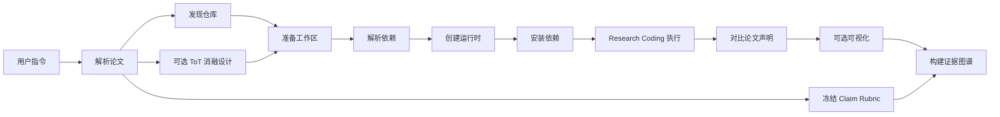
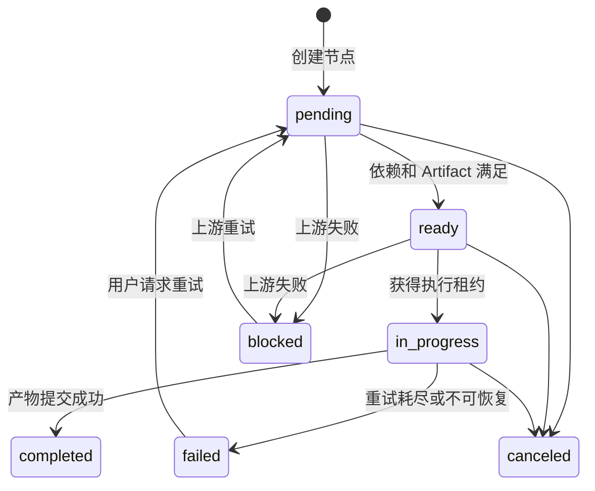

# 概述与架构

> [返回目录](./README.md)

---

## 什么是论文复现

论文复现（Paper Reproduction）是指根据学术论文的描述，重新实现论文中提出的方法、算法或系统，并验证其结果是否与论文声称一致的过程。

传统论文复现面临的挑战：

| 挑战 | 传统方式 | Sea-Mult-Agent 方式 |
|------|----------|---------------------|
| **论文理解** | 人工阅读、提取方法 | LLM 自动解析、提取主张 |
| **代码准备** | 手动搜索仓库、解决依赖 | 自动发现仓库、安装依赖 |
| **执行验证** | 手动运行、对比结果 | 自动执行、受限调试、证据闭环 |
| **结果验收** | 粗略判断"能否运行" | 分层 Rubric、逐主张证据判定 |
| **可复现性** | 依赖个人经验 | 结构化证据图谱、可审计 |

`✶ Insight ─────────────────────────────────────`
**论文复现的三个层次：**
1. **能运行** - 代码可以成功执行
2. **结果一致** - 输出指标与论文声明匹配
3. **方法正确** - 实现符合论文描述的方法论
`─────────────────────────────────────────────────`

---

## Sea-Mult-Agent 核心理念

### 四大设计原则

```
┌─────────────────────────────────────────────────────────────────┐
│                    核心设计原则                                  │
├─────────────────────────────────────────────────────────────────┤
│                                                                 │
│  1. 控制面与执行面分离                                          │
│     Backend 负责任务规划、状态和调度                            │
│     Docker Sandbox 负责不可信代码执行                           │
│                                                                 │
│  2. Artifact 驱动协作                                           │
│     Agent 不共享隐式内存                                        │
│     下游通过命名 Artifact 接收上游结果                           │
│                                                                 │
│  3. 模型负责建议，代码负责约束                                   │
│     LLM 可以规划、生成和修复                                    │
│     DAG 校验、预算、哈希、指标重算由确定性代码执行               │
│                                                                 │
│  4. 自动化必须有边界                                            │
│     ToT、ReAct、重试、并发、运行时长和样本数都有明确上限         │
│                                                                 │
└─────────────────────────────────────────────────────────────────┘
```

### 为什么需要这些原则？

| 问题 | 解决原则 | 效果 |
|------|----------|------|
| **模型幻觉** | 代码负责约束 | 不能伪造指标、哈希、证据 |
| **无限循环** | 自动化有边界 | 重试、预算、时间都有上限 |
| **隐式依赖** | Artifact 驱动 | 显式契约、可追踪、可审计 |
| **安全风险** | 控制执行分离 | 不可信代码在隔离容器执行 |

---

## 整体架构

### 三层架构

```
┌─────────────────────────────────────────────────────────────────┐
│                         前端层 (Frontend)                        │
│  ┌──────────────────────────────────────────────────────────┐  │
│  │  React + TypeScript 工作台                                │  │
│  │  - 对话界面                                               │  │
│  │  - DAG 可视化                                             │  │
│  │  - 证据图谱展示                                           │  │
│  │  - PDF 阅读                                               │  │
│  └──────────────────────────────────────────────────────────┘  │
└─────────────────────────────────────────────────────────────────┘
                              │ REST / SSE
                              ▼
┌─────────────────────────────────────────────────────────────────┐
│                         控制层 (Backend)                         │
│  ┌──────────────┐  ┌──────────────┐  ┌──────────────┐         │
│  │   Planner    │  │  Scheduler   │  │    Agent     │         │
│  │  生成 DAG    │  │  任务调度    │  │  执行任务    │         │
│  └──────────────┘  └──────────────┘  └──────────────┘         │
│  ┌──────────────┐  ┌──────────────┐  ┌──────────────┐         │
│  │  PlanStore   │  │  EventBus    │  │  Sandbox     │         │
│  │  持久化      │  │  SSE 推送    │  │  Client      │         │
│  └──────────────┘  └──────────────┘  └──────────────┘         │
└─────────────────────────────────────────────────────────────────┘
                              │ HTTP
                              ▼
┌─────────────────────────────────────────────────────────────────┐
│                         执行层 (Sandbox)                         │
│  ┌──────────────────────────────────────────────────────────┐  │
│  │  Docker Sandbox Service                                   │  │
│  │  - 创建/销毁容器                                          │  │
│  │  - 执行 Python 代码                                       │  │
│  │  - 资源限制 (CPU/内存/PID)                                │  │
│  │  - 流式输出回传                                           │  │
│  └──────────────────────────────────────────────────────────┘  │
└─────────────────────────────────────────────────────────────────┘
```

### 核心组件

| 组件 | 技术 | 职责 | 端口 |
|------|------|------|------|
| **Frontend** | React + Vite | 用户界面、DAG 可视化、证据图谱 | 5173 |
| **Backend** | Go + Gin | API、规划、调度、Agent 编排 | 8080 |
| **Sandbox** | Go + Docker | 容器生命周期、代码执行 | 8082 |

---

## 执行流程

### 标准论文复现主链



### 关键节点

| 节点 | Agent | 输入 | 输出 |
|------|-------|------|------|
| **paper_parse** | Librarian | 论文 URL/上传 | `parsed_paper` |
| **claim_rubric_extract** | Librarian | `parsed_paper` | `claim_rubric` |
| **repo_discovery** | Coder | 论文信息 | `repo_url` |
| **repo_prepare** | Coder | `repo_url` | `workspace_path`, `repo_manifest` |
| **resolve_dependencies** | Coder | `repo_manifest` | `dependency_spec` |
| **prepare_runtime** | Sandbox | `dependency_spec` | `prepared_runtime` |
| **install_dependencies** | Sandbox | `prepared_runtime` | `installed_runtime` |
| **paper_code_execute** | Research Coding | 工作区、运行时 | `run_metrics`, `paper_debug_report` |
| **paper_compare** | Data | `run_metrics`, `claim_rubric` | `comparison_report` |
| **claim_evidence_build** | Data | 所有 Artifact | `claim_evidence_graph` |

---

## Agent 角色

### 专业分工

```
┌─────────────┐
│   Planner   │ ← 将用户目标拆解为 DAG
└──────┬──────┘
       │
       ├─→ Librarian Agent    ← 论文解析、声明提取、Rubric 冻结
       ├─→ Coder Agent        ← 代码生成、依赖解析、运行时准备
       ├─→ Research Coding    ← 论文仓库调试、Benchmark 适配
       ├─→ Data Agent         ← 指标分析、报告生成、证据判定
       └─→ Chat Agent         ← 通用问答
```

### 职责边界

| Agent | 负责 | 不负责 |
|-------|------|--------|
| **Librarian** | 论文解析、主张提取 | 代码执行 |
| **Coder** | 代码生成、依赖解析 | 论文仓库调试 |
| **Research Coding** | 论文调试、Benchmark 适配 | 论文检索、容器生命周期 |
| **Data** | 指标分析、证据判定 | 写入或修复仓库源码 |
| **Chat** | 通用问答 | 专业科研任务 |

---

## 核心数据模型

### PlanGraph

```go
type PlanGraph struct {
    ID           string              // 计划唯一 ID
    OwnerID      string              // 所有者
    Intent       string              // 用户原始指令
    Nodes        map[string]TaskNode // DAG 节点
    Artifacts    map[string]Artifact // 已生产的产物
    Budget       BudgetConfig        // 预算配置
    Status       PlanStatus          // 计划状态
    CreatedAt    time.Time
}
```

### TaskNode

```go
type TaskNode struct {
    ID                string            // 节点 ID
    Type              string            // 任务类型
    AssignedTo        string            // 分配的 Agent
    Dependencies      []string          // 依赖节点
    RequiredArtifacts []string          // 必需的上游产物
    OutputArtifacts   []string          // 输出的产物
    Status            TaskStatus        // 节点状态
    Priority          int               // 优先级
    RetryCount        int               // 重试次数
}
```

### Artifact

```go
type Artifact struct {
    ID          string                 // 产物 ID
    Name        string                 // 产物名称（如 "run_metrics"）
    Type        string                 // 类型（如 "metrics", "report"）
    Value       interface{}            // 实际值
    Producer    string                 // 生产者节点 ID
    SHA256      string                 // 内容哈希
    Metadata    map[string]interface{} // 元数据
    CreatedAt   time.Time
}
```

### 任务状态机



---

## 关键设计模式

### 1. Artifact 驱动协作

**问题**：Agent 之间如何传递数据？

**传统方式**：共享内存、全局变量、隐式依赖

**Sea-Mult-Agent 方式**：显式命名产物

```go
// 节点 A 输出
Artifact{
    Name: "repo_url",
    Value: "https://github.com/user/repo",
}

// 节点 B 输入
RequiredArtifacts: ["repo_url"]

// 节点 B 可以直接使用
workspacePath = task.Inputs["repo_url"].(string)
```

**优势**：
- ✅ 显式依赖，可追踪
- ✅ 自动校验完整性
- ✅ 支持 DAG 可视化
- ✅ 便于审计和回放

### 2. 执行租约

**问题**：如何处理重试、取消、重分配？

**解决方案**：每个节点执行时分配 `execution_id` 和 `lease_owner`

```go
type Lease struct {
    ExecutionID    string    // 执行 ID
    LeaseOwner     string    // 租约持有者
    ExecutionEpoch int64     // 执行轮次
    ExpiresAt      time.Time // 过期时间
}
```

**作用**：
- 防止并发执行冲突
- 支持取消后丢弃迟到结果
- 支持重分配使旧租约失效

### 3. 预算受限

**问题**：如何防止无限重试、无限搜索？

**解决方案**：明确预算上限

```go
type BudgetConfig struct {
    MaxTaskAttempts    int   // 任务尝试次数上限
    MaxDurationSeconds int   // 总时长上限
    MaxConcurrent      int   // 最大并发数
}
```

**默认值**：
- 最大任务尝试次数：100
- 最大总时长：2100 秒（35 分钟）
- 最大并发数：2

---

## 技术选型

### 控制层

| 组件 | 技术选型 | 理由 |
|------|----------|------|
| Web 框架 | Gin | 高性能、中间件丰富 |
| 数据存储 | 文件系统 (JSON) | 单机原型、原子写入 |
| 事件推送 | SSE | 实时、简单、兼容性好 |
| 状态机 | 自研 | 满足 DAG 调度需求 |

### 执行层

| 组件 | 技术选型 | 理由 |
|------|----------|------|
| 容器引擎 | Docker | 标准、隔离性好 |
| 资源限制 | cgroups | CPU/内存/PID 限制 |
| 执行协议 | HTTP | 简单、易扩展 |

### 前端层

| 组件 | 技术选型 | 理由 |
|------|----------|------|
| 框架 | React 19 | 现代、生态好 |
| 构建工具 | Vite | 快速、HMR |
| DAG 可视化 | React Flow | 成熟、可定制 |
| 类型系统 | TypeScript | 类型安全 |

---

## 相关文档

- [下一章：论文解析与Rubric冻结](./02-论文解析与Rubric冻结.md)
- [返回目录](./README.md)