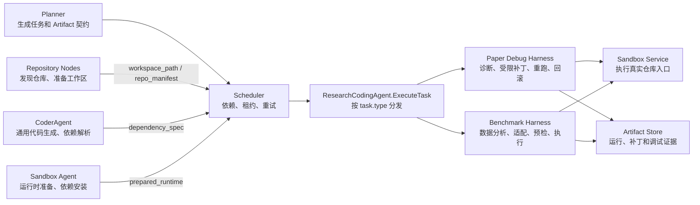
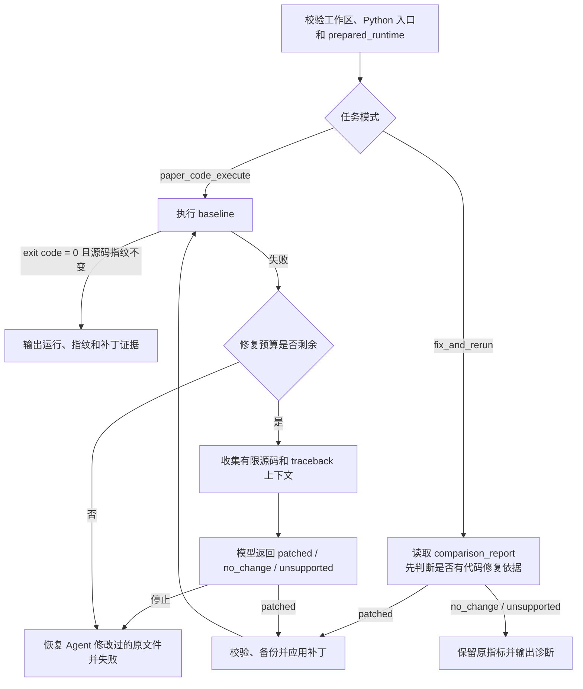

# 论文代码调试

> [返回目录](./README.md)

---

## 什么是论文代码调试

论文代码调试是指在论文复现过程中，当代码运行失败或结果与论文不一致时，通过**受限的**自动补丁生成和验证来修复问题的过程。

**核心特点**：

| 特性 | 说明 |
|------|------|
| **受限** | 只修改已存在的 Python 文件、有限源码上下文 |
| **最小化** | 生成最小补丁，而非重写整个仓库 |
| **可回滚** | 失败时自动恢复原始文件 |
| **证据闭环** | 记录补丁路径、原因、前后哈希 |

`✶ Insight ─────────────────────────────────────`
**为什么需要受限调试？**
1. **安全** - 不能让模型随意修改仓库代码
2. **可审计** - 每个补丁都有记录
3. **可回滚** - 失败不影响原始代码
4. **不越界** - 不能解决缺数据、缺硬件等问题
`─────────────────────────────────────────────────`

---

## Research Coding Agent 架构

### 在系统中的位置



### 与其他 Agent 的边界

| 角色 | 负责 | 不负责 |
|------|------|--------|
| **Repository Nodes** | 确定性发现仓库、克隆并准备工作区 | 生成或修复仓库代码 |
| **CoderAgent** | 通用代码生成、依赖解析 | 根据论文运行错误修改仓库源码 |
| **Sandbox Agent** | 创建隔离运行时、安装依赖 | 决定该改哪段论文代码 |
| **ResearchCodingAgent** | 在已有工作区和运行时中诊断、受控修改、重跑、回滚 | 论文检索、容器生命周期、最终科研结论判断 |
| **DataAgent** | 对比论文声明、分析指标、生成报告 | 写入或修复仓库源码 |

---

## 执行状态机

### 论文代码调试流程



### 报告状态与任务结果

| 报告状态 | 含义 | 任务结果 |
|----------|------|----------|
| `passed` | 首次或未改代码的运行成功 | `completed`，发布运行 Artifact |
| `repaired` | 应用至少一个受控补丁后运行成功 | `completed`，发布运行与补丁 Artifact |
| `no_change` | 结果差异证据不足以支持代码修改 | `fix_and_rerun` 完成并保留原指标 |
| `unsupported` | 问题需要缺失的数据、模型、凭证、硬件或人工判断 | `fix_and_rerun` 完成并记录原因 |
| `failed` | baseline 无法修复、补丁非法、执行异常或预算耗尽 | 任务失败；回滚 Agent 补丁 |

---

## 受限补丁机制

### 调试边界

```
┌─────────────────────────────────────────────────────────────────┐
│                    调试边界约束                                  │
├─────────────────────────────────────────────────────────────────┤
│                                                                 │
│  ✅ 允许的操作：                                                │
│    - 修改临时克隆工作区中的现有 Python 文件                     │
│    - 生成最小补丁（修复运行错误）                               │
│    - 最多修改 3 个文件，每轮 1 次修复                           │
│                                                                 │
│  ❌ 禁止的操作：                                                │
│    - 修改原始远端仓库                                           │
│    - 引入 pip install、shell 安装                               │
│    - mock/fake 论文方法                                         │
│    - 硬编码指标或凭证                                           │
│    - 越界路径、符号链接、空补丁                                 │
│                                                                 │
└─────────────────────────────────────────────────────────────────┘
```

### 固定预算

| 边界 | 当前值 | 说明 |
|------|--------|------|
| **总执行次数** | 3 | 包括初始运行和重试 |
| **总修复轮数** | 2 | 每轮调用一次 LLM |
| **每轮最多修改文件** | 3 | 单次补丁的文件数 |
| **模型最多读取源码文件** | 8 | 提供给 LLM 的上下文 |
| **单文件上限** | 96 KiB | 超过则不读取 |
| **总源码上下文上限** | 256 KiB | 总 token 限制 |
| **单次 stdout/stderr 预览** | 4000 bytes | 错误日志截断 |

---

## 内部步骤

### 步骤 1：入口校验

```go
func (h *PaperDebugHarness) validateEntry(workspacePath, entryFile, runtimeID string) error {
    // 1. 工作区必须是普通目录
    info, err := os.Stat(workspacePath)
    if err != nil || !info.IsDir() {
        return errors.New("workspace must be a directory")
    }

    // 2. 入口必须是工作区内现有、非符号链接的 .py 文件
    entryPath := filepath.Join(workspacePath, entryFile)
    info, err = os.Stat(entryPath)
    if err != nil {
        return errors.New("entry file not found")
    }
    if info.Mode()&os.ModeSymlink != 0 {
        return errors.New("entry must not be a symlink")
    }
    if filepath.Ext(entryFile) != ".py" {
        return errors.New("entry must be a Python file")
    }

    // 3. 运行时 ID 必须来自上游 prepared_runtime
    if runtimeID == "" {
        return errors.New("missing runtime ID")
    }

    return nil
}
```

### 步骤 2：真实执行

```go
func (h *PaperDebugHarness) executeCode(ctx context.Context, workspacePath, entryFile, runtimeID string) (*ExecutionResult, error) {
    // 在已挂载工作区中执行 python3 <entry>
    cmd := fmt.Sprintf("python3 %s", entryFile)
    result, err := h.sandboxClient.ExecuteCommand(ctx, runtimeID, cmd, workspacePath)

    // stdout/stderr 实时回传
    return result, err
}
```

### 步骤 3：上下文收集

```go
func (h *PaperDebugHarness) collectContext(workspacePath, entryFile string, stderr string) ([]SourceFile, error) {
    var files []SourceFile
    totalSize := 0

    // 1. 优先读取入口文件
    entryPath := filepath.Join(workspacePath, entryFile)
    content, err := os.ReadFile(entryPath)
    if err == nil && len(content) <= 96*1024 {
        files = append(files, SourceFile{
            Path:    entryFile,
            Content: string(content),
        })
        totalSize += len(content)
    }

    // 2. 读取 traceback 命中的文件
    tracebackFiles := extractTracebackFiles(stderr)
    for _, relPath := range tracebackFiles {
        if len(files) >= 8 || totalSize >= 256*1024 {
            break
        }
        path := filepath.Join(workspacePath, relPath)
        content, err := os.ReadFile(path)
        if err == nil && len(content) <= 96*1024 {
            files = append(files, SourceFile{
                Path:    relPath,
                Content: string(content),
            })
            totalSize += len(content)
        }
    }

    // 3. 读取 repo_manifest 候选
    // ...

    return files, nil
}
```

### 步骤 4：修复提议

```go
func (h *PaperDebugHarness) proposeFix(ctx context.Context, files []SourceFile, stderr string) (*PatchProposal, error) {
    prompt := fmt.Sprintf(`
你是一个代码调试助手。以下代码运行失败，请分析错误并生成最小补丁修复问题。

错误日志：
%s

相关源码文件：
%s

请按以下格式返回：
1. patched / no_change / unsupported
2. 如果是 patched，提供：
   - 文件路径
   - 完整替换内容
   - 修复原因
`, stderr, formatSourceFiles(files))

    response, err := h.chatModel.Generate(ctx, prompt)
    if err != nil {
        return nil, err
    }

    return parsePatchProposal(response)
}
```

### 步骤 5：Go 端校验

```go
func (h *PaperDebugHarness) validatePatch(workspacePath string, patch *PatchProposal) error {
    for _, filePatch := range patch.Files {
        targetPath := filepath.Join(workspacePath, filePatch.Path)

        // 1. 目标必须是模型已看到的现有文件
        if !fileExists(targetPath) {
            return errors.New("target file not found")
        }

        // 2. 拒绝越界路径
        if !isWithinWorkspace(workspacePath, targetPath) {
            return errors.New("path escapes workspace")
        }

        // 3. 拒绝符号链接
        if isSymlink(targetPath) {
            return errors.New("target must not be a symlink")
        }

        // 4. 拒绝空补丁
        if len(filePatch.Content) == 0 {
            return errors.New("empty patch")
        }

        // 5. 检查禁止构造
        if containsForbiddenConstructs(filePatch.Content) {
            return errors.New("patch contains forbidden constructs")
        }
    }

    return nil
}

func containsForbiddenConstructs(code string) bool {
    forbidden := []string{
        "pip install",
        "apt-get install",
        "subprocess.run",
        "os.system",
        "mock.",
        "fake.",
    }

    for _, pattern := range forbidden {
        if strings.Contains(code, pattern) {
            return true
        }
    }

    return false
}
```

### 步骤 6：写入与重跑

```go
func (h *PaperDebugHarness) applyPatchAndRerun(ctx context.Context, workspacePath string, patch *PatchProposal) (*ExecutionResult, error) {
    // 1. 首次修改前保存内容和权限
    backups := make(map[string]FileBackup)
    for _, filePatch := range patch.Files {
        targetPath := filepath.Join(workspacePath, filePatch.Path)

        // 读取原始内容
        original, err := os.ReadFile(targetPath)
        if err != nil {
            return nil, err
        }

        // 保存备份
        backups[filePatch.Path] = FileBackup{
            Content:  string(original),
            Mode:     getFileMode(targetPath),
            Checksum: sha256(original),
        }

        // 2. 原子替换文件
        if err := atomicWriteFile(targetPath, []byte(filePatch.Content), backups[filePatch.Path].Mode); err != nil {
            // 失败时恢复
            h.restoreBackups(workspacePath, backups)
            return nil, err
        }
    }

    // 3. 在同一运行时重跑
    result, err := h.executeCode(ctx, workspacePath, h.entryFile, h.runtimeID)
    if err != nil {
        // 失败时恢复
        h.restoreBackups(workspacePath, backups)
        return nil, err
    }

    return result, nil
}
```

### 步骤 7：成功提交或失败回滚

```go
func (h *PaperDebugHarness) finalizeExecution(result *ExecutionResult, patch *PatchProposal, backups map[string]FileBackup) (*TaskResult, error) {
    if result.ExitCode == 0 {
        // 成功：保留补丁并写入哈希
        patchManifest := PatchManifest{
            Files: make([]PatchRecord, 0, len(patch.Files)),
        }

        for _, filePatch := range patch.Files {
            targetPath := filepath.Join(h.workspacePath, filePatch.Path)
            newContent, _ := os.ReadFile(targetPath)

            patchManifest.Files = append(patchManifest.Files, PatchRecord{
                Path:         filePatch.Path,
                Reason:       filePatch.Reason,
                OldChecksum:  backups[filePatch.Path].Checksum,
                NewChecksum:  sha256(newContent),
            })
        }

        return &TaskResult{
            Status: "completed",
            Artifacts: map[string]interface{}{
                "run_metrics":          result.Stdout,
                "paper_debug_report":   h.generateReport(result, patch),
                "paper_patch_manifest": patchManifest,
            },
        }, nil
    } else {
        // 失败：恢复所有被 Agent 修改的文件
        h.restoreBackups(h.workspacePath, backups)

        return &TaskResult{
            Status: "failed",
            Error:  fmt.Sprintf("execution failed after patch: %s", result.Stderr),
        }, nil
    }
}
```

---

## 代码实现

### Paper Debug Harness

```go
// backend/internal/agent/paper_debug_harness.go

type PaperDebugHarness struct {
    chatModel     ChatModel
    sandboxClient SandboxClient
    workspacePath string
    entryFile     string
    runtimeID     string

    // 固定预算
    maxExecutions    int
    maxFixRounds     int
    maxFilesPerRound int
    maxSourceFiles   int
    maxFileSize      int64
    maxTotalSize     int64
}

func (h *PaperDebugHarness) Execute(ctx context.Context) (*TaskResult, error) {
    // 1. 校验入口
    if err := h.validateEntry(h.workspacePath, h.entryFile, h.runtimeID); err != nil {
        return nil, err
    }

    // 2. 执行 baseline
    result, err := h.executeCode(ctx, h.workspacePath, h.entryFile, h.runtimeID)
    if err != nil {
        return nil, err
    }

    // 3. 如果成功，直接返回
    if result.ExitCode == 0 {
        return &TaskResult{
            Status: "completed",
            Artifacts: map[string]interface{}{
                "run_metrics":        result.Stdout,
                "paper_debug_report": Report{Status: "passed"},
            },
        }, nil
    }

    // 4. 失败时进入修复循环
    return h.fixAndRerun(ctx, result)
}

func (h *PaperDebugHarness) fixAndRerun(ctx context.Context, initialResult *ExecutionResult) (*TaskResult, error) {
    executionCount := 1
    fixRound := 0

    for executionCount < h.maxExecutions && fixRound < h.maxFixRounds {
        fixRound++

        // 1. 收集上下文
        files, err := h.collectContext(h.workspacePath, h.entryFile, initialResult.Stderr)
        if err != nil {
            return nil, err
        }

        // 2. 请求修复提议
        proposal, err := h.proposeFix(ctx, files, initialResult.Stderr)
        if err != nil {
            return nil, err
        }

        // 3. 判断是否继续
        if proposal.Decision != "patched" {
            return &TaskResult{
                Status: "completed",
                Artifacts: map[string]interface{}{
                    "run_metrics":        initialResult.Stdout,
                    "paper_debug_report": Report{Status: proposal.Decision, Reason: proposal.Reason},
                },
            }, nil
        }

        // 4. 校验补丁
        if err := h.validatePatch(h.workspacePath, proposal); err != nil {
            return nil, err
        }

        // 5. 应用补丁并重跑
        result, err := h.applyPatchAndRerun(ctx, h.workspacePath, proposal)
        executionCount++

        if err != nil {
            continue // 继续下一轮修复
        }

        // 6. 如果成功，返回
        if result.ExitCode == 0 {
            return h.finalizeExecution(result, proposal, nil)
        }

        // 7. 更新错误日志
        initialResult = result
    }

    // 8. 预算耗尽，失败
    return &TaskResult{
        Status: "failed",
        Error:  "fix budget exhausted",
    }, nil
}
```

---

## 实际示例

### 场景：导入错误

**错误日志**：
```
Traceback (most recent call last):
  File "train.py", line 15, in <module>
    from transformer import Transformer
ModuleNotFoundError: No module named 'transformer'
```

**上下文**：
- `train.py` (入口文件)
- `model/transformer.py` (实际位置)

**修复提议**：
```python
# train.py

# 原代码
from transformer import Transformer

# 修复后
from model.transformer import Transformer
```

**补丁记录**：
```json
{
  "files": [
    {
      "path": "train.py",
      "reason": "Fix incorrect import path",
      "old_checksum": "abc123",
      "new_checksum": "def456"
    }
  ]
}
```

---

## 调试边界案例

### 案例 1：缺数据

**错误**：`FileNotFoundError: data/train.csv not found`

**判定**：`unsupported` - 需要下载许可证数据

**理由**：代码修复无法解决缺数据问题

### 案例 2：缺 GPU

**错误**：`RuntimeError: CUDA out of memory`

**判定**：`unsupported` - 需要更大 GPU 内存

**理由**：代码修复无法解决硬件限制

### 案例 3：论文口径不一致

**错误**：指标与论文不一致

**判定**：`no_change` - 证据不足以证明代码有缺陷

**理由**：可能是数据、预处理、评测口径差异

---

## 相关文档

- [上一章：仓库发现与环境准备](./03-仓库发现与环境准备.md)
- [下一章：自有数据Benchmark](./05-自有数据Benchmark.md)
- [返回目录](./README.md)