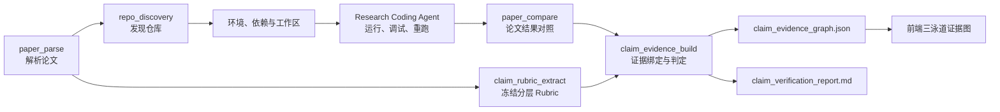

# Claim-Evidence 证据图

> [返回目录](./README.md)

---

## 什么是 Claim-Evidence 证据图

Claim-Evidence 证据图是论文复现的核心验收机制，它把论文复现从简单的"代码能否运行"拆分成**四层可独立验收**的对象：

```
论文 -> 顶层主张 -> 可独立打分的准则 -> 真实运行证据
```

**核心价值**：

| 传统方式 | Claim-Evidence 方式 |
|----------|---------------------|
| ❌ 单一成功标记 | ✅ 分层验收对象 |
| ❌ "看起来差不多" | ✅ 明确准则、可量化 |
| ❌ 隐式判断 | ✅ 证据与主张绑定 |
| ❌ 不可审计 | ✅ 三泳道可视化 |

`✶ Insight ─────────────────────────────────────`
**为什么需要四层结构？**
1. **论文** - 研究问题的整体描述
2. **主张** - 论文声称的具体结论（如"准确率 28.4"）
3. **准则** - 验收主张的独立标准（如"BLEU 分数在 27.4-29.4 范围"）
4. **证据** - 实际运行的产物（如 `run_metrics`、`comparison_report`）
`─────────────────────────────────────────────────`

---

## 功能定位

### 两个固定节点

| 节点 | Agent | 时机 | 输出 |
|------|-------|------|------|
| `claim_rubric_extract` | Librarian | 论文解析后、仓库实验前 | `claim_rubric`、`claim_rubric_report` |
| `claim_evidence_build` | Data | 对比、修复重跑和可选绘图后 | `claim_evidence_graph`、`claim_verification_report` |

### 执行架构



**关键约束**：Rubric 必须在查看运行结果之前冻结，后续节点只能引用它的 ID 和 SHA-256，不能根据实验结果改写验收标准。

---

## 数据契约

### Frozen Rubric

```json
{
  "version": "claim.rubric/v1",
  "paper_title": "Attention Is All You Need",
  "source_artifact": "parsed_paper",
  "sha256": "e3b0c44298fc1c149afbf4c8996fb92427ae41e4649b934ca495991b7852b855",
  "claims": [
    {
      "id": "claim-001",
      "title": "Translation Quality (Big Model)",
      "statement": "The Transformer (big) achieves 28.4 BLEU on WMT 2014 En-De.",
      "source_locator": "Table 1, Row 'Transformer (big)'",
      "claim_type": "quantitative",
      "importance": 0.9,
      "criteria": [
        {
          "id": "claim-001.criterion-01",
          "description": "Evaluate BLEU score on WMT 2014 En-De test set.",
          "metric_name": "BLEU",
          "expected_value": 28.4,
          "tolerance": 1.0,
          "required_evidence": ["paper", "run", "metric"]
        }
      ]
    }
  ]
}
```

### Evidence Graph

```json
{
  "version": "claim.evidence/v1",
  "rubric_id": "claim-2026-07-17-001",
  "rubric_sha256": "abc123...",
  "claims": [
    {
      "id": "claim-001",
      "title": "Translation Quality (Big Model)",
      "statement": "The Transformer (big) achieves 28.4 BLEU...",
      "source_locator": "Table 1, Row 'Transformer (big)'",
      "claim_type": "quantitative",
      "criteria": [
        {
          "id": "claim-001.criterion-01",
          "description": "Evaluate BLEU score on WMT 2014 En-De test set.",
          "status": "verified",
          "confidence": 0.95,
          "observed_value": 28.2,
          "justification": "Within tolerance (28.4 ± 1.0)",
          "evidence_refs": [
            {
              "artifact_name": "run_metrics",
              "artifact_type": "metrics",
              "artifact_sha256": "def456...",
              "summary": "BLEU: 28.2, Training time: 3.2 days"
            }
          ]
        }
      ]
    }
  ],
  "summary": {
    "total_claims": 5,
    "total_criteria": 12,
    "verified": 8,
    "partially_reproduced": 2,
    "unverifiable": 1,
    "blocked_by_missing_asset": 1,
    "evidence_coverage": 0.67
  }
}
```

---

## 判定边界

### 允许的状态

| 状态 | 含义 | 条件 |
|------|------|------|
| `verified` | 所有准则都有直接执行证据支持 | 至少引用一个执行产物 |
| `partially_reproduced` | 只有部分准则或部分目标达到 | 部分证据支持 |
| `contradicted` | 直接证据与论文主张冲突 | 证据与声明矛盾 |
| `unverifiable` | 当前证据不足，不能下结论 | 无证据或模型失败 |
| `blocked_by_missing_asset` | 缺数据、权重、凭证、授权资产或必要硬件 | 明确缺少必要资产 |

### Go Harness 校验

```go
func ValidateEvidenceGraph(graph ClaimEvidenceGraph, rubric ClaimRubric) error {
    // 1. claim_id 和 criterion_id 必须来自冻结 Rubric
    for _, claim := range graph.Claims {
        if !rubric.HasClaim(claim.ID) {
            return errors.New("unknown claim ID")
        }
        for _, criterion := range claim.Criteria {
            if !rubric.HasCriterion(criterion.ID) {
                return errors.New("unknown criterion ID")
            }
        }
    }

    // 2. 每个准则必须恰好返回一次
    for _, rubricClaim := range rubric.Claims {
        for _, rubricCrit := range rubricClaim.Criteria {
            if !graph.HasCriterionResult(rubricCrit.ID) {
                return errors.New("missing criterion result")
            }
        }
    }

    // 3. 状态和置信度必须在白名单与数值范围内
    for _, claim := range graph.Claims {
        for _, criterion := range claim.Criteria {
            if !isValidStatus(criterion.Status) {
                return errors.New("invalid status")
            }
            if criterion.Confidence < 0 || criterion.Confidence > 1 {
                return errors.New("confidence out of range")
            }
        }
    }

    // 4. verified / partially_reproduced / contradicted 必须引用执行产物
    for _, claim := range graph.Claims {
        for _, criterion := range claim.Criteria {
            if criterion.Status == "verified" || criterion.Status == "partially_reproduced" || criterion.Status == "contradicted" {
                if len(criterion.EvidenceRefs) == 0 {
                    return errors.New("status requires evidence")
                }
                for _, ref := range criterion.EvidenceRefs {
                    if !isValidExecutionArtifact(ref.ArtifactName) {
                        return errors.New("invalid evidence type")
                    }
                }
            }
        }
    }

    return nil
}

func isValidExecutionArtifact(name string) bool {
    validArtifacts := []string{
        "run_metrics",
        "rerun_metrics",
        "comparison_report",
        "result_plot",
    }
    for _, valid := range validArtifacts {
        if name == valid {
            return true
        }
    }
    return false
}
```

---

## 前端可视化

### 三泳道布局

```
┌─────────────────────────────────────────────────────────────────┐
│                    Claim-to-Evidence 证据图                      │
├─────────────────────────────────────────────────────────────────┤
│                                                                 │
│  泳道 1：论文主张                                                │
│  ┌──────────────┐                                              │
│  │ 主张 1       │ 🟢 已验证                                     │
│  │ BLEU: 28.4   │                                              │
│  └──────┬───────┘                                              │
│         │                                                       │
│  泳道 2：独立判定准则                                            │
│         ├──┬──────────┐                                        │
│         │  │ 准则 1   │ 🟢 已验证                               │
│         │  │ BLEU 在  │                                        │
│         │  │ 27.4-29.4│                                        │
│         │  └────┬─────┘                                        │
│         │       │                                               │
│  泳道 3：运行证据                                                │
│         │       ├──┬──────────┐                                │
│         │       │  │ run_metrics│ 🟢 可用                      │
│         │       │  │ BLEU: 28.2 │                              │
│         │       │  └───────────┘                                │
│         │       │                                               │
│         │       ├──┬──────────┐                                │
│         │       │  │ comparison │ 🟢 可用                      │
│         │       │  │ 差异: 0.2  │                              │
│         │       │  └───────────┘                                │
│                                                                 │
│  图例：🟢 已验证  🟡 部分复现  🔴 与证据矛盾  ⚪ 不可验证         │
│        🔵 缺少必要资产                                          │
│                                                                 │
└─────────────────────────────────────────────────────────────────┘
```

### React Flow 实现

```tsx
// frontend/src/features/claim-evidence/ClaimEvidenceGraphView.tsx

import ReactFlow, { Node, Edge } from 'reactflow';

interface ClaimEvidenceGraphProps {
  graph: ClaimEvidenceGraph;
}

export function ClaimEvidenceGraphView({ graph }: ClaimEvidenceGraphProps) {
  const nodes: Node[] = [];
  const edges: Edge[] = [];

  let yOffset = 0;

  // 泳道 1：论文主张
  graph.claims.forEach((claim, claimIdx) => {
    nodes.push({
      id: claim.id,
      type: 'claimNode',
      data: {
        title: claim.title,
        statement: claim.statement,
        status: getClaimStatus(claim),
      },
      position: { x: 100, y: yOffset },
    });

    // 泳道 2：判定准则
    claim.criteria.forEach((criterion, critIdx) => {
      nodes.push({
        id: criterion.id,
        type: 'criterionNode',
        data: {
          description: criterion.description,
          status: criterion.status,
          confidence: criterion.confidence,
        },
        position: { x: 300, y: yOffset + critIdx * 100 },
      });

      edges.push({
        id: `${claim.id}-${criterion.id}`,
        source: claim.id,
        target: criterion.id,
        type: 'smoothstep',
      });

      // 泳道 3：运行证据
      criterion.evidence_refs.forEach((ref, refIdx) => {
        nodes.push({
          id: `${criterion.id}-${ref.artifact_name}`,
          type: 'evidenceNode',
          data: {
            name: ref.artifact_name,
            type: ref.artifact_type,
            sha256: ref.artifact_sha256,
            summary: ref.summary,
          },
          position: { x: 500, y: yOffset + critIdx * 100 + refIdx * 60 },
        });

        edges.push({
          id: `${criterion.id}-${ref.artifact_name}`,
          source: criterion.id,
          target: `${criterion.id}-${ref.artifact_name}`,
          type: 'smoothstep',
        });
      });
    });

    yOffset += claim.criteria.length * 120 + 50;
  });

  return (
    <div style={{ width: '100%', height: '800px' }}>
      <ReactFlow nodes={nodes} edges={edges} />
    </div>
  );
}

function getClaimStatus(claim: Claim): string {
  const statuses = claim.criteria.map(c => c.status);
  if (statuses.every(s => s === 'verified')) return 'verified';
  if (statuses.some(s => s === 'verified')) return 'partially_reproduced';
  if (statuses.some(s => s === 'contradicted')) return 'contradicted';
  if (statuses.some(s => s === 'blocked_by_missing_asset')) return 'blocked_by_missing_asset';
  return 'unverifiable';
}
```

---

## 实际示例

### 完整证据图

**论文**：Attention Is All You Need

**主张 1**：Translation Quality (Big Model)
- 准则 1：BLEU 分数在 27.4-29.4
  - 证据：`run_metrics` - BLEU: 28.2 ✅
  - 状态：**verified**

**主张 2**：Training Efficiency
- 准则 1：训练时间在 10-14 小时
  - 证据：`run_metrics` - Time: 11.5h ✅
  - 状态：**verified**

**主张 3**：Ablation Study
- 准则 1：移除 attention scaling 性能下降
  - 证据：`comparison_report` - 下降 2.1 BLEU ✅
  - 状态：**verified**

**主张 4**：Multi-Head Attention Contribution
- 准则 1：不同 head 数量的影响
  - 证据：缺失（未运行消融实验）❌
  - 状态：**unverifiable**

**总结**：
- 总主张：4
- 总准则：8
- 已验证：6 (75%)
- 不可验证：2 (25%)
- 证据覆盖率：75%

---

## 代码实现

### Evidence Builder

```go
// backend/internal/agent/claim_evidence.go

type ClaimEvidenceBuilder struct {
    chatModel ChatModel
    rubric    ClaimRubric
    artifacts map[string]Artifact
}

func (b *ClaimEvidenceBuilder) Build(ctx context.Context) (*ClaimEvidenceGraph, error) {
    // 1. 验证 Rubric 完整性
    if err := ValidateRubric(b.rubric); err != nil {
        return nil, err
    }

    // 2. 准备上下文
    context := b.prepareContext()

    // 3. 调用 LLM 判定
    prompt := fmt.Sprintf(`
你是一个论文复现验收助手。请根据以下信息判定每个准则的状态。

Rubric:
%s

实际运行证据:
%s

请按以下格式输出：
1. 准则 ID
2. 状态 (verified / partially_reproduced / contradicted / unverifiable / blocked_by_missing_asset)
3. 置信度 (0-1)
4. 观测值
5. 判定理由
6. 引用的证据 ID
`, formatRubric(b.rubric), formatArtifacts(b.artifacts))

    response, err := b.chatModel.Generate(ctx, prompt)
    if err != nil {
        // 模型不可用时，所有准则保持 unverifiable
        return b.buildDefaultGraph(), nil
    }

    // 4. 解析 LLM 输出
    rawResults, err := parseJudgments(response)
    if err != nil {
        return b.buildDefaultGraph(), nil
    }

    // 5. 构建 Evidence Graph
    graph := b.buildGraph(rawResults)

    // 6. Go 端校验
    if err := ValidateEvidenceGraph(graph, b.rubric); err != nil {
        return nil, err
    }

    // 7. 计算统计
    graph.Summary = b.computeSummary(graph)

    return graph, nil
}

func (b *ClaimEvidenceBuilder) buildGraph(rawResults []RawJudgment) *ClaimEvidenceGraph {
    graph := &ClaimEvidenceGraph{
        Version:       "claim.evidence/v1",
        RubricID:      b.rubric.ID,
        RubricSHA256:  b.rubric.SHA256,
        Claims:        make([]ClaimEvidence, 0, len(b.rubric.Claims)),
    }

    for _, rubricClaim := range b.rubric.Claims {
        claim := ClaimEvidence{
            ID:             rubricClaim.ID,
            Title:          rubricClaim.Title,
            Statement:      rubricClaim.Statement,
            SourceLocator:  rubricClaim.SourceLocator,
            ClaimType:      rubricClaim.ClaimType,
            Criteria:       make([]CriterionEvidence, 0, len(rubricClaim.Criteria)),
        }

        for _, rubricCrit := range rubricClaim.Criteria {
            result := b.findJudgment(rawResults, rubricCrit.ID)
            if result == nil {
                // 漏判：整体降级
                result = &RawJudgment{
                    CriterionID: rubricCrit.ID,
                    Status:      "unverifiable",
                    Reason:      "missing judgment",
                }
            }

            criterion := CriterionEvidence{
                ID:           rubricCrit.ID,
                Description:  rubricCrit.Description,
                Status:       result.Status,
                Confidence:   result.Confidence,
                ObservedValue: result.ObservedValue,
                Justification: result.Reason,
                EvidenceRefs:  b.buildEvidenceRefs(result.EvidenceIDs),
            }

            claim.Criteria = append(claim.Criteria, criterion)
        }

        graph.Claims = append(graph.Claims, claim)
    }

    return graph
}

func (b *ClaimEvidenceBuilder) computeSummary(graph *ClaimEvidenceGraph) EvidenceSummary {
    summary := EvidenceSummary{}

    for _, claim := range graph.Claims {
        summary.TotalClaims++
        summary.TotalCriteria += len(claim.Criteria)

        for _, criterion := range claim.Criteria {
            switch criterion.Status {
            case "verified":
                summary.Verified++
            case "partially_reproduced":
                summary.PartiallyReproduced++
            case "contradicted":
                summary.Contradicted++
            case "unverifiable":
                summary.Unverifiable++
            case "blocked_by_missing_asset":
                summary.BlockedByMissingAsset++
            }

            if len(criterion.EvidenceRefs) > 0 {
                summary.EvidenceCoverage++
            }
        }
    }

    if summary.TotalCriteria > 0 {
        summary.EvidenceCoverage = summary.EvidenceCoverage / float64(summary.TotalCriteria)
    }

    return summary
}
```

---

## 验证与测试

```go
func TestClaimEvidenceGraphValidation(t *testing.T) {
    // 创建有效 Rubric
    rubric := ClaimRubric{
        Version: "claim.rubric/v1",
        Claims: []Claim{
            {
                ID: "claim-001",
                Criteria: []Criterion{
                    {ID: "claim-001.criterion-01"},
                },
            },
        },
    }
    rubric.SHA256 = computeSHA256(rubric)

    // 创建有效 Evidence Graph
    graph := ClaimEvidenceGraph{
        Version:      "claim.evidence/v1",
        RubricID:     rubric.ID,
        RubricSHA256: rubric.SHA256,
        Claims: []ClaimEvidence{
            {
                ID: "claim-001",
                Criteria: []CriterionEvidence{
                    {
                        ID:     "claim-001.criterion-01",
                        Status: "verified",
                        EvidenceRefs: []EvidenceRef{
                            {ArtifactName: "run_metrics"},
                        },
                    },
                },
            },
        },
    }

    // 验证成功
    assert.NoError(t, ValidateEvidenceGraph(graph, rubric))
}

func TestEvidenceGraphMissingCriterion(t *testing.T) {
    // 漏判：整体降级
    rubric := ClaimRubric{
        Claims: []Claim{
            {
                ID: "claim-001",
                Criteria: []Criterion{
                    {ID: "claim-001.criterion-01"},
                    {ID: "claim-001.criterion-02"}, // 缺失
                },
            },
        },
    }

    graph := ClaimEvidenceGraph{
        Claims: []ClaimEvidence{
            {
                ID: "claim-001",
                Criteria: []CriterionEvidence{
                    {ID: "claim-001.criterion-01", Status: "verified"},
                    // 缺失 claim-001.criterion-02
                },
            },
        },
    }

    // 验证失败
    assert.Error(t, ValidateEvidenceGraph(graph, rubric))
}

func TestVerifiedRequiresEvidence(t *testing.T) {
    // verified 状态必须引用证据
    graph := ClaimEvidenceGraph{
        Claims: []ClaimEvidence{
            {
                ID: "claim-001",
                Criteria: []CriterionEvidence{
                    {
                        ID:           "claim-001.criterion-01",
                        Status:       "verified", // 无证据
                        EvidenceRefs: []EvidenceRef{},
                    },
                },
            },
        },
    }

    // 验证失败
    assert.Error(t, ValidateEvidenceGraph(graph, rubric))
}
```

---

## 当前限制

- **语义判定仍依赖模型** - Go 只验证证据引用与边界，不理解所有领域指标
- **静态快照** - 当前图是一次计划内的静态证据快照，还没有跨多次运行的时间序列对比
- **未实现人工覆核** - 尚未实现人工逐准则覆核、签名和双人审批
- **Smoke 限制** - Smoke 复现只能支持对应范围内的结论，不能自动升级为完整论文复现

---

## 相关文档

- [上一章：自有数据Benchmark](./05-自有数据Benchmark.md)
- [下一章：ToT消融设计](./07-ToT消融设计.md)
- [返回目录](./README.md)